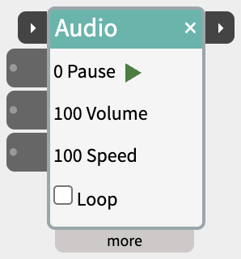
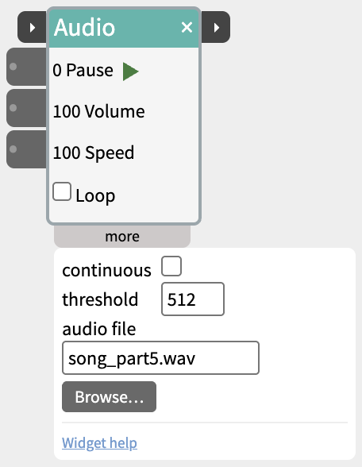

# Audio

Play a sound file, started and stopped by a sensor, a button or another widget.

Audio plays one sound file - one of the samples that come with NTK, or any file on your computer. It can play while an input is held high (a button held down, someone standing in front of a sensor), or play the whole clip through when it's started, and tell the next widget when it has finished.

## Contents

- [Trying it](#Trying-it)
- [Two ways to play](#Two-ways-to-play)
- [Trigger and next](#Trigger-and-next)
- [Inlets](#Inlets)
- [Settings in the more panel](#Settings-in-the-more-panel)
- [Notes](#Notes)

## Trying it

Click the small ▶ button next to **Play** to play the clip, and again to stop it. Nothing needs to be wired in. The title bar glows amber while it plays.

## Two ways to play

- **Play** (the first input in the body) - plays while its value is above the threshold, and stops when it drops below. With **Loop** off, stopping rewinds the clip to the start; with Loop on, it pauses where it is and carries on from there next time. Use this for "play while the button is held" or "play while someone is near".
- **trigger** (on the title bar) - plays the clip from the beginning when its value rises past the threshold, and keeps playing to the end when it drops again. Use this for "play the whole clip when this happens", including starting from another widget's next pulse.

## Trigger and next

The two small ▸ ports on the title bar chain Audio with other steps:

- **trigger** (left) - plays from the beginning, as above. A trigger that arrives while the clip is already playing is ignored.
- **next** (right) - when the clip plays to its end, sends 1023 for a fifth of a second, then 0, and flashes amber. With Loop on the clip never ends, so next never fires. Stopping it with Play or the ▶ button doesn't fire it either.

Wire **next** into the **trigger** of the following step - another Audio, a [Scene](https://www.netlabtoolkit.org/documentation/widgets/scene/), a [SpeechOut](https://www.netlabtoolkit.org/documentation/widgets/speechout/) - and it begins as soon as the sound has finished.

## Inlets

- **trigger** - on the title bar (see above).
- **Play** - plays while above the threshold.
- **Volume** - 0 to 100.
- **Speed** - 100 is normal speed, 50 half speed, 200 double.

## Settings in the more panel

- **continuous** - plays all the time, whatever Play is doing. Combine with Loop for a background sound.
- **threshold** - the level Play and trigger have to rise past (512 by default).
- **audio file** - one of the samples that come with NTK: `song_part1.wav` to `song_part6.wav`.
- **Browse…** - pick a sound file on your computer instead (MP3, WAV, M4A, AAC, OGG or FLAC). Typing a sample name in **audio file** switches back to it.

## Notes

- **Loop** is in the body, under Speed, so it can be switched while you try things.
- A file picked with Browse is saved in the patch as a path on your computer, so a patch shared with someone else needs the file at the same place.
