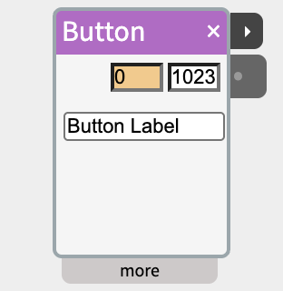
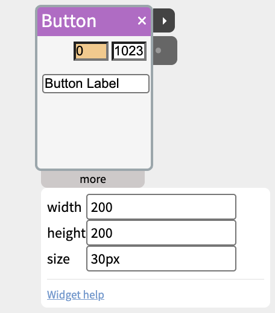

# Button

A button on the screen, for trying a patch with no hardware connected, or as part of a screen-based prototype.

Button puts a clickable button on the NTK canvas. While it's held down, its output is the on value (1023 by default); let go and it goes back to the off value (0). Each press also sends a pulse from its **next** port, which starts widgets such as Scene, Sequence, Audio or SpeechOut - so a whole chain can be built and tried on screen before any hardware is wired up.

## Contents

- [Trying it](#Trying-it)
- [Held or pressed](#Held-or-pressed)
- [Settings in the more panel](#Settings-in-the-more-panel)
- [Notes](#Notes)

## Trying it

Add a Button and the button itself appears on the canvas, with a small **Drag** handle under it for moving it. Click it and watch the widget's on value light up while you hold it.

## Held or pressed

Button has two outputs for two kinds of use:

- **out** (the outlet in the body) - the on value while the button is held, the off value otherwise. Use it for anything that follows the button: an LED that lights while it's held, [Audio](https://www.netlabtoolkit.org/documentation/widgets/audio/)'s Play, a Gate.
- **next** (the ▸ port on the right of the title bar) - sends 1023 for a fifth of a second on each press, and flashes amber. Use it to start something that should run to its end - a [Scene](https://www.netlabtoolkit.org/documentation/widgets/scene/), a [Sequence](https://www.netlabtoolkit.org/documentation/widgets/sequence/), a [SpeechOut](https://www.netlabtoolkit.org/documentation/widgets/speechout/) - or to step a [Count](https://www.netlabtoolkit.org/documentation/widgets/count/).

The same two outputs are on [DigitalIn](https://www.netlabtoolkit.org/documentation/widgets/digitalin/), so a Button used while building a patch can be swapped for a real button later with the same cables.

## Settings in the more panel

- The **off** and **on** values are the two fields in the widget's body (0 and 1023 by default), and the button's label is the field below them.
- **width** and **height** - the size of the button on the canvas, in pixels.
- **size** - the label's font size, e.g. `30px`.

## Notes

- A tap on a touch screen counts as one press, the same as a click.
