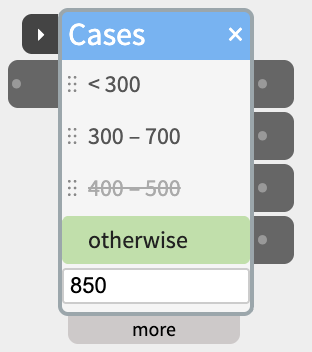
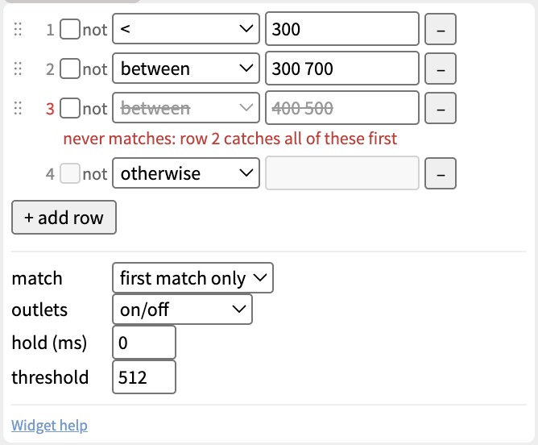

# Cases

Sort one input into cases - "too dark", "just right", "too bright", or "yes", "no", "anything else" - and send each case out of its own outlet.

 700 struck through, 100 – 200 and otherwise - each with an outlet beside it on the right. The first row is highlighted green because the input box at the bottom holds 850">

Each row is a test, and each row has its own outlet beside it. When the input arrives, Cases tests it against the rows from the top, and the row that matches lights up green and switches its outlet on. Add as many rows as the decision needs, from 1 to 12 - the widget grows with them.

## Contents

- [Tests](#Tests)
- [Rows and their outlets](#Rows-and-their-outlets)
- [Trying it without anything wired in](#Trying-it-without-anything-wired-in)
- [Rows that can never match](#Rows-that-can-never-match)
- [Trigger](#Trigger)
- [Inlets and outlets](#Inlets-and-outlets)
- [Settings in the more panel](#Settings-in-the-more-panel)
- [Examples](#Examples)
- [Notes](#Notes)

## Tests

For numbers - from a sensor, a knob, anything that sends a value:

- **>** and **<** - more than, or less than, the value.
- **=** - exactly the value. It also takes a word, for text.
- **between** - from the first number to the second, both included. Type `300 700`, `300, 700` or `300 to 700`.

For text - from SpeechIn, an LLM, Text, a Webhook:

- **is** - the whole input is one of the words or phrases. Separate them with commas: `yes, yeah, sure`.
- **contains** - the input has one of the words or phrases in it, as whole words: `contains hi` matches "hi there" but not "this".
- **starts with** and **ends with** - the input begins or ends with one of them.

Text tests ignore capital letters, and spaces at the start and end.

And:

- **otherwise** - matches when no row above it does. It always stays the last row.
- **not** - tick it to turn a row's test around: `not between 300 700` matches anything outside that range, including text.

An empty input matches nothing, not even otherwise.

## Rows and their outlets

Rows are tested from the top. With **first match only** (the default), the first row that matches is the one that lights - so put the narrow cases above the wide ones. With **all matches**, every row that matches lights at once - useful for text that can mention two things.

Each row keeps its own outlet, and the outlet's cable stays with the row:

- **Add a row** with **+ add row** in the more panel. It copies the last test, so you only change what's different.
- **Move a row** by dragging it - in the body, or by its ⋮⋮ grip in the more panel. Its cable moves with it.
- **Delete a row** with its **−** button in the more panel. Its cables are deleted with it.

Hover over a row or an outlet to see its test in full.

## Trying it without anything wired in

- **Type into the box** at the bottom of the body - a number or some text - and the rows light as they would for a real input.
- **Click a row** to send its outlet as if it had matched, to try what's wired to it.

## Rows that can never match

A row that can never match is struck through in the body, and the more panel says why under it, in red:

- **an earlier row catches all of these first** - for example `> 300` below `> 200`, a copied row you haven't changed yet, or `starts with hi` below `starts with h`. Move it up, or change its test.
- **it needs a value** - the test box is empty.

Rows caught by earlier ones are only marked with **first match only** - with **all matches**, every row that matches lights.

## Trigger

With nothing wired to the **trigger** port on the title bar, Cases tests the input every time it changes. Wire something into trigger, and Cases tests the input only when trigger rises past the threshold (512 by default) - so it decides once, when something has happened, not on every change.

Use it for text that arrives in pieces, or a sensor you only want read at a moment:

```
SpeechIn ─text→ in─ Cases
SpeechIn ─next→ trigger─┘
```

Cases has no next port: it takes no time. With **outlets** set to **pulse**, each row's outlet is the next for its own branch - wire it into the trigger of what should happen in that case. See [Chaining Widgets - Trigger and Next](https://www.netlabtoolkit.org/chaining-widgets/).

## Inlets and outlets

- **trigger** - on the title bar (see above).
- **in** - the number or text to test.
- **one outlet per row**, beside it, named by its test.

## Settings in the more panel



- **The rows** - for each row: the grip to drag it by, **not**, the test, its value, and **−** to delete it. Then **+ add row**.
- **match** - **first match only**, or **all matches** (see [Rows and their outlets](#Rows-and-their-outlets)).
- **outlets** - what the outlets send:
    - **on/off** (the default) - 1023 while the row matches, 0 when it doesn't. Right for a light, a motor, a Gate.
    - **pulse** - 1023 for a fifth of a second when a row starts matching, then 0. Right for starting a Scene, an Audio clip or SpeechOut.
    - **pass through** - a matching row sends the input itself; the other rows keep their last value. Right for sending a sensor's value one way or another.
- **hold (ms)** - a new match has to last this long before the outlets change, so a sensor that wobbles near a boundary doesn't flicker between two rows. 0 (the default) changes at once. Set it to a few hundred milliseconds, not seconds: while you turn a knob, nothing changes until it rests that long.
- **threshold** - the level the trigger port has to rise past (512 by default).

## Examples

### Three levels of light

Rows: `< 300`, `between 300 700`, `otherwise`. A light sensor into **in**, and each outlet into its own DigitalOut LED: one LED is on at a time.

### Answering a question

Rows: `contains yes, yeah, sure`, `contains no, nope`, `otherwise`. SpeechIn's text into **in** and its next into **trigger**; outlets set to **pulse**, each into the trigger of a SpeechOut with a different reply.

### Sending a value one way or another

Rows: `< 512`, `otherwise`; outlets set to **pass through**. A Knob into **in**: below the middle, its value goes out of the first outlet to one Servo; above it, out of the second to another.

## Notes

- Cases doesn't run on the board in standalone patches yet - it needs NTK running.
- Cases ignores the input a patch had when it was saved: nothing fires when a patch opens until a new input arrives.
