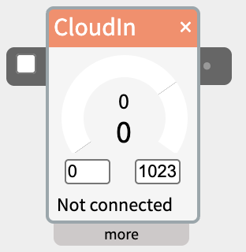
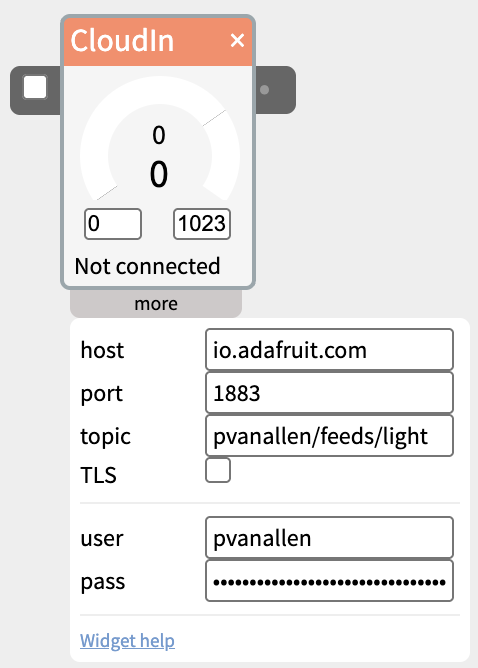

# CloudIn

The CloudIn widget subscribes to an [MQTT](https://en.wikipedia.org/wiki/MQTT) topic on any broker and sends incoming values out its outlet - use it to receive data published by another device, script, cloud service, or dashboard.

## Contents

- [How it works](#How-it-works)
- [Settings in the more panel](#Settings-in-the-more-panel)
- [Sharing a broker with CloudOut](#Sharing-a-broker-with-CloudOut)
- [Getting your Adafruit IO account details](#Getting-your-Adafruit-IO-account-details)
- [Troubleshooting](#Troubleshooting)

## How it works

- CloudIn connects to the broker at **host**/**port** and subscribes to **topic**. Updates push in immediately when a message arrives - there's no polling interval to configure.
- The checkbox on the left edge turns the widget on and off. **It is off by default** - check it to receive values.
- The status line under the dial says what the connection is doing. Hover over it for the broker's full message:
  - **Connected** - connected to the broker.
  - **No data yet** - connected and listening, but nothing has arrived on this topic yet. If something should be publishing, check the **topic** (topics are case-sensitive).
  - **Not connected** - the checkbox is off, or it hasn't connected yet.
  - **Bad user/pass**, **Host not found**, **Refused**, **Timed out**, **No host set** - the connection failed, and why. **Connect error** for anything else.
  - **Topic error** - connected, but the broker rejected this topic (on Adafruit IO, usually a topic not in the `USERNAME/feeds/FEEDKEY` form).
- The raw incoming value is shown in the upper display, scaled to the output range set by the two range fields, and sent out the outlet (shown in the lower display).
- The dial in the widget body lets you **simulate an incoming message** - drag it to send a test value (0-1023) out the outlet without a broker connected at all. Use it to build and verify the rest of your patch before the sender is set up.

## Settings in the more panel

- **host** - the broker's address (e.g. `io.adafruit.com`, or a LAN IP for a broker on your own network).
- **port** - the broker's port. `1883` is the standard plain (non-TLS) MQTT port; `8883` is the standard TLS port.
- **topic** - the MQTT topic to subscribe to.
- **TLS** - check this if the broker requires an encrypted connection. Leave it off for a plain local broker; most self-hosted brokers (e.g. Mosquitto) don't require it, but some hosted services do.
- **user** / **pass** - credentials, if the broker requires them. Leave blank for a broker that allows anonymous connections.

## Sharing a broker with CloudOut

CloudIn and CloudOut widgets pointed at the same **host**/**port** share one underlying connection to that broker, so you don't need a separate connection per widget.

The first widget to actually connect sets the username/password/TLS for that shared connection - if you point two widgets at the same broker with different credentials, whichever connects first wins for the rest of that session. Remove and re-add a widget to force a fresh connection attempt with corrected credentials.

**Don't point CloudIn and CloudOut at the same topic on the same broker in one patch.** MQTT has no way to tell a client "don't deliver my own published messages back to me," so a connection that both publishes and subscribes to one topic sees its own messages as if they'd arrived from somewhere else. NTK detects and suppresses this to avoid a feedback loop, which as a side effect means CloudIn will never receive anything on a topic CloudOut is also publishing to. Use two different topics (or two feeds, if you're using Adafruit IO) for two-way testing.

## Getting your Adafruit IO account details

CloudIn can receive from [io.adafruit.com](https://io.adafruit.com/), Adafruit's cloud data service (free tier available). You'll need a free Adafruit account, plus these three pieces of information from it: username, AIO key, feed key.

1. **Create an account** - Sign up or log in at [io.adafruit.com](https://io.adafruit.com/).
2. **Find your username** - It's shown in the upper left of the Adafruit IO dashboard.
3. **Find or create your AIO Key** - Go to the io.adafruit.com overview and find the yellow KEY icon in the top right of the header and click. This shows your **ADAFRUIT IO KEY** - a long string in the Active Key field. Treat it like a password: anyone with it can read and write your feeds.
4. **Find or create your feed key** - All feeds you've created are listed on the main overview page. To create a new feed, click on Feeds in the top menu, then **New Feed** and give it a name. Its key is usually the lowercase, dashed version of whatever name you gave the feed (a feed named "Kitchen Temp" gets the key `kitchen-temp`) - use the exact key shown, not the display name, if the two differ.

Then fill in CloudIn's "more" panel:

- **host** - `io.adafruit.com`, with **port** `1883` (or `8883` with **TLS** checked).
- **topic** - `USERNAME/feeds/FEEDKEY`, e.g. `yourname/feeds/kitchen-temp`. Adafruit IO rejects a topic in any other form.
- **user** - your username.
- **pass** - your AIO key.

Then check the CloudIn checkbox.

## Troubleshooting

- **Stays "Not connected"** - double check **host**/**port**/**TLS** match the broker exactly, and that **user**/**pass** are correct if the broker requires them.
- **Shows "No data yet"** - confirm **topic** exactly matches what's being published (topics are case-sensitive), and that something is actually publishing to it. Also check you're not pointed at the same topic as a CloudOut in the same patch (see above).
- **Adafruit IO specifically rejects the connection** - check their dashboard's own MQTT error log (visible on the feed's page) for the exact reason; a malformed topic (not `USERNAME/feeds/FEEDKEY`) is a common cause.
- **The value jumps to a huge number** - the incoming values are outside the output range you've set; adjust the range fields to match what's actually being published.
