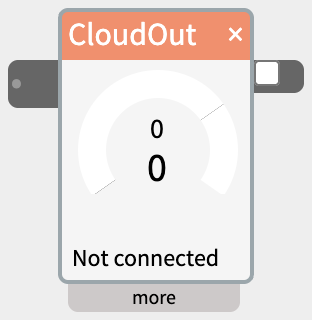

# CloudOut

The CloudOut widget publishes its incoming value to an [MQTT](https://en.wikipedia.org/wiki/MQTT) topic on any broker whenever it changes - use it to send data to another device, script, cloud dashboard, or automation.

## Contents

- [How it works](#How-it-works)
- [Settings in the more panel](#Settings-in-the-more-panel)
- [Sharing a broker with CloudIn](#Sharing-a-broker-with-CloudIn)
- [Getting your Adafruit IO account details](#Getting-your-Adafruit-IO-account-details)
- [Troubleshooting](#Troubleshooting)

## How it works

- Wire a widget into CloudOut's inlet (left edge). CloudOut connects to the broker at **host**/**port** and publishes to **topic**.
- The checkbox on the right edge turns sending on and off. **It is off by default** - nothing is sent until you check it, and CloudOut never auto-reconnects on its own when a patch loads, even if it was checked when the patch was saved.
- The upper display shows the incoming value. The lower display shows the last value CloudOut actually sent, and stays on that number until the next real send - it does not continuously track the incoming value the way the upper display does. Each time a value is sent, it **blinks red**, then fades back to black over the **min ms** interval.
- Under the status line, **send in 1.2s** counts down to the next moment CloudOut is allowed to send (see **min ms** below). It's **red** while counting: a new value arriving then waits until the countdown ends. Grey means the next change goes out straight away.
- The status line under the dial says what the connection is doing. Hover over it for the broker's full message:
  - **Connected** - connected to the broker, ready to send.
  - **Not connected** - the checkbox is off, or it hasn't connected yet.
  - **Bad user/pass**, **Host not found**, **Refused**, **Timed out**, **No host set** - the connection failed, and why. **Connect error** for anything else.
  - **Topic error** - connected, but the broker rejected this topic (on Adafruit IO, usually a topic not in the `USERNAME/feeds/FEEDKEY` form).
- The dial in the widget body lets you **send test messages by hand** - drag it to publish a value (0-1023) without wiring anything into the inlet. Use it to confirm the receiving side is set up correctly before building the rest of the patch.
- CloudOut only sends when the value actually changes. Sending the same value twice in a row produces just one message.

## Settings in the more panel

- **host** - the broker's address (e.g. `io.adafruit.com`, or a LAN IP for a broker on your own network).
- **port** - the broker's port. `1883` is the standard plain (non-TLS) MQTT port; `8883` is the standard TLS port.
- **topic** - the MQTT topic to publish to.
- **TLS** - check this if the broker requires an encrypted connection. Leave it off for a plain local broker; most self-hosted brokers (e.g. Mosquitto) don't require it, but some hosted services do.
- **user** / **pass** - credentials, if the broker requires them. Leave blank for a broker that allows anonymous connections.
- **min ms** - the minimum time, in milliseconds, between actual sends (default `5000`). Rate-limited services (Adafruit IO's free tier allows 30 points/minute) need this set comfortably above their limit; set to `0` to send on every change with no minimum.
- **avg** - when checked, and **min ms** is above `0`, CloudOut publishes the *mean* of every value it saw during that interval instead of just whatever value happened to be current when the interval closed. Useful for a noisy or fast-changing input where you want a representative value rather than a snapshot. Once the input stops changing, CloudOut sends one more message with the exact final value (not an average) so the last thing published always matches where the input actually settled.

## Sharing a broker with CloudIn

CloudIn and CloudOut widgets pointed at the same **host**/**port** share one underlying connection to that broker, so you don't need a separate connection per widget.

The first widget to actually connect sets the username/password/TLS for that shared connection - if you point two widgets at the same broker with different credentials, whichever connects first wins for the rest of that session. Remove and re-add a widget to force a fresh connection attempt with corrected credentials.

**Don't point CloudOut and CloudIn at the same topic on the same broker in one patch.** MQTT has no way to tell a client "don't deliver my own published messages back to me," so a connection that both publishes and subscribes to one topic sees its own messages as if they'd arrived from somewhere else. NTK detects and suppresses this to avoid a feedback loop, which as a side effect means a CloudIn on the same topic will never receive anything. Use two different topics (or two feeds, if you're using Adafruit IO) for two-way testing.

## Getting your Adafruit IO account details

CloudOut can send to [io.adafruit.com](https://io.adafruit.com/), Adafruit's cloud data service (free tier available). You'll need a free Adafruit account, plus these three pieces of information from it: username, AIO key, feed key.

1. **Create an account** - Sign up or log in at [io.adafruit.com](https://io.adafruit.com/).
2. **Find your username** - It's shown in the upper left of the Adafruit IO dashboard.
3. **Find or create your AIO Key** - Go to the io.adafruit.com overview and find the yellow KEY icon in the top right of the header and click. This shows your **ADAFRUIT IO KEY** - a long string in the Active Key field. Treat it like a password: anyone with it can read and write your feeds.
4. **Find or create your feed key** - All feeds you've created are listed on the main overview page. To create a new feed, click on Feeds in the top menu, then **New Feed** and give it a name. Its key is usually the lowercase, dashed version of whatever name you gave the feed (a feed named "Kitchen Temp" gets the key `kitchen-temp`) - use the exact key shown, not the display name, if the two differ.

Then fill in CloudOut's "more" panel:

- **host** - `io.adafruit.com`, with **port** `1883` (or `8883` with **TLS** checked).
- **topic** - `USERNAME/feeds/FEEDKEY`, e.g. `yourname/feeds/kitchen-temp`. Adafruit IO rejects a topic in any other form.
- **user** - your username.
- **pass** - your AIO key.
- **min ms** - at least `2000`, to stay under the free tier's limit of 30 data points a minute.

Then check the CloudOut checkbox.

## Troubleshooting

- **Stays "Not connected"** - double check **host**/**port**/**TLS** match the broker exactly, and that **user**/**pass** are correct if the broker requires them.
- **Connects, then immediately disconnects, repeatedly** - on Adafruit IO specifically, check their dashboard's own MQTT error log (visible on the feed's page) for the exact reason; a malformed **topic** (not `USERNAME/feeds/FEEDKEY`) is a common cause, and the broker drops the whole connection rather than just rejecting that one message.
- **Getting rate-limited** - raise **min ms**, and check **avg** if you want a representative value from a fast-changing input rather than whatever it happened to be at the last instant.
- **The receiver never sees an initial value on startup** - CloudOut only sends on change; nudge the input so a real change happens.
