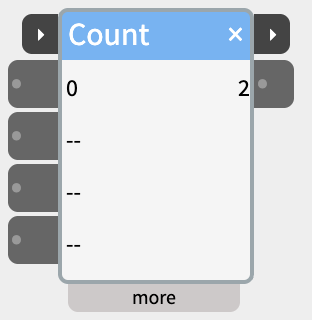
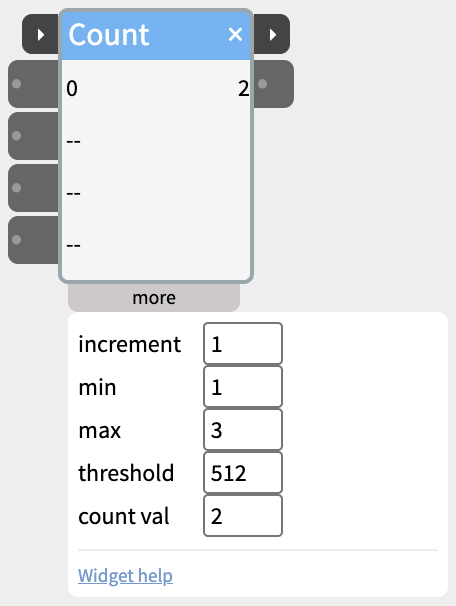

# Count

Count things that happen - button presses, a sensor going past a level, another widget finishing - and act when the count gets there.



Each time one of Count's inputs rises past the threshold (512 by default), the count goes up by one step. When it reaches max, the **next** port on its title bar sends a short pulse, and the following count wraps round to min. Use it for "after three presses, start the scene", to step through a list, or to number events as they happen.

## Contents

- [Counting every N things](#Counting-every-N-things)
- [Trigger and next](#Trigger-and-next)
- [Inlets and outlets](#Inlets-and-outlets)
- [Settings in the more panel](#Settings-in-the-more-panel)
- [Notes](#Notes)

## Counting every N things

**min** is the first value a count reaches, and **max** is the last. To have next fire every N counts, set **min 1** and **max N**. With min 1 and max 3:

```
press → 1, press → 2, press → 3 + next, press → 1, press → 2, press → 3 + next ...
```

Every round takes exactly three presses, and the count shows how many have happened so far.

Starting from min 0 works too, but 0 then counts as one of the steps: with min 0 and max 3 a round is four presses (0, 1, 2, 3), and after a reset the count shows -1 until the first press.

To count down, set the step (**increment**) to -1: the count goes from max to min, and next fires when it lands on min.

## Trigger and next

The two small ▸ ports on the title bar connect Count with widgets that take time, such as Scene, Sequence or SpeechOut:

- **trigger** (left) - counts one, the same as a press on in1, in2 or in3. Wire another widget's next into it to count how many times that widget has finished.
- **next** (right) - when a count lands on max (min when counting down), sends 1023 for a fifth of a second, then 0, and flashes amber. Wire it into the trigger of the next step.

For example, a [Button](https://www.netlabtoolkit.org/documentation/widgets/button/) or [DigitalIn](https://www.netlabtoolkit.org/documentation/widgets/digitalin/) next into in1, and Count's next into a [Scene](https://www.netlabtoolkit.org/documentation/widgets/scene/)'s trigger: the scene plays on every third press.

## Inlets and outlets

- **trigger** - on the title bar (see above).
- **in1**, **in2**, **in3** - each counts one when it rises past the threshold. They all count into the same total, so up to three sources - three buttons, or the next pulses of three widgets - can be counted together. Rises arriving at the same moment each count.
- **reset** (the fourth input) - back to nothing counted, so the next count lands on min (max when counting down). Hover over an input to see its name.
- **out1** - the count.
- **next** - on the title bar (see above).

## Settings in the more panel



- **increment** - how much each count adds: 1 by default, -1 to count down, or any other step.
- **min** and **max** - the range the count goes round. See [Counting every N things](#Counting-every-N-things).
- **threshold** - the level an input has to rise past to count (512 by default). A value already above it doesn't count again until it has dropped below.
- **count val** - the count now. Type a value to set it.

## Notes

- Count runs on the board in standalone patches, with trigger, next and reset working as they do in NTK.
- Patches saved before NTK 2026.14.0 used in4 as a fourth count input. It's a reset now; a cable wired to it stays connected, so move it to in1-in3 if it was counting.
