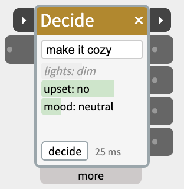
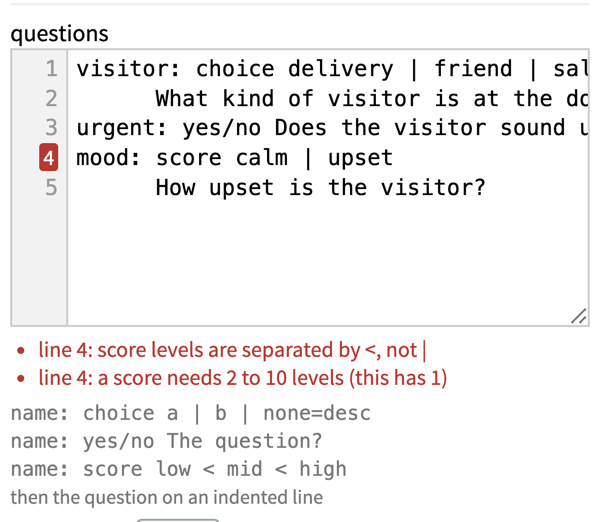
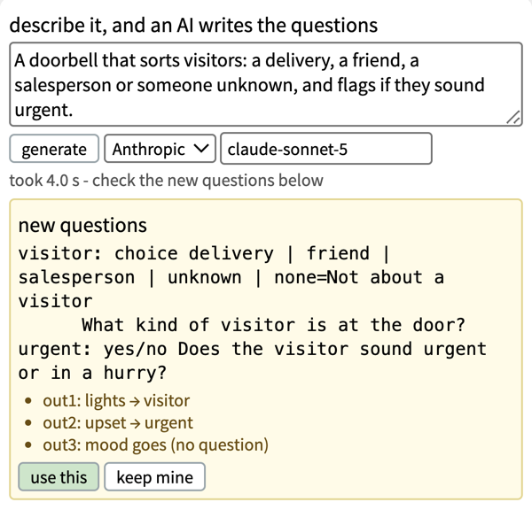
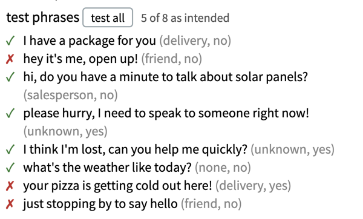
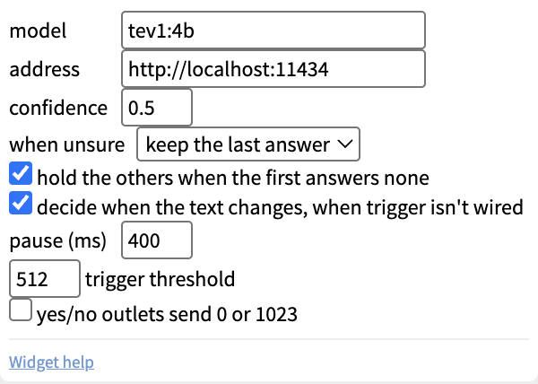

# Decide

Decide reads a piece of text and answers a few questions about it, faster than LLMs. Wire in what someone said (from SpeechIn), a label from ObjectRecog, or a reply from an LLM widget, and Decide answers questions like *what does the speaker want the lights to do?* or *is the speaker annoyed?* — one outlet per question.



*"make it cozy": `lights: dim` is grey — the model was only 39% sure, so its outlet didn't change. The green bars show how sure each answer is; the time is how long the decision took.*

It uses a **[decision model](https://www.forbes.com/sites/ronschmelzer/2026/10/12/decisions-decisions-a-guide-to-the-new-wave-of-ai-decision-models-besides-jev/)** like [JEV](https://typesafe.ai/blog/introducing-system-one-models-and-jev), which is a new kind of AI model that doesn't write text, it only picks from the answers you give it, and says how sure it is. That makes it much quicker than an LLM (a few tenths of a second instead of seconds) and it can never reply with something you didn't expect. It understands indirect speech: "make it cozy" can come out as *dim*, "it's pitch black in here" as *on*.

Decide runs the decision model on your own computer with [Ollama](https://ollama.com), so nothing you say leaves the computer.

## Contents

- [Setting up](#Setting-up)
- [Trying it](#Trying-it)
- [The questions](#The-questions)
- [Letting an AI write the questions](#Letting-an-AI-write-the-questions)
- [Outlets](#Outlets)
- [When an answer does not change its outlet](#When-an-answer-does-not-change-its-outlet)
- [When it decides](#When-it-decides)
- [Trigger and next](#Trigger-and-next)
- [Settings in the more panel](#Settings-in-the-more-panel)
- [Good uses](#Good-uses)
- [When to use something else](#When-to-use-something-else)
- [Notes](#Notes)

## Setting up

1. Install [Ollama](https://ollama.com) (version 0.35 or later) and start it.
2. Download a decision model in Terminal: `ollama pull tev1:4b`

`tev1:4b` is the default: quick, and fits a Mac with 16 GB of memory. Others you can pick in the **more** panel:

- `nimble` — the most accurate, but needs about 18 GB of memory while it runs (a Mac with 32 GB).
- `kev:4b-mlx-bf16` — the fastest that's still good, but weaker on score questions.

## Trying it

Type in the text box at the top of the widget — for example *turn the lights off please* — and the answers appear underneath after a moment. Each line shows a question and its answer, with a green bar for how sure the model is. Press Enter or click **decide** to decide straight away.

This works with nothing wired in, so you can check your questions before connecting a microphone or any hardware.

## The questions

The questions are written in the **more** panel, one per outlet (up to four), in a short format:

```
lights: choice on | off | dim | none=Not about the lights
        What does the speaker want the lights to do?
upset:  yes/no Is the speaker frustrated or annoyed?
mood:   score calm < neutral < agitated
        How agitated is the speaker?
```

Each question starts with a name and a colon, then one of three types:

- **choice** — pick one of the options, separated by `|`. Add `=` and a few words after an option if its name alone isn't clear (`none=Not about the lights`). Decide adds a `none` option if you don't, so text that fits nothing doesn't have to be forced into one of your options. 2 to 26 options.
- **yes/no** — the question goes on the same line.
- **score** — a scale, lowest first, separated by `<`. 2 to 10 levels.

For choice and score, the question itself goes on the next line, indented. Lines starting with `#` are notes and are ignored.

Mistakes are listed under the box as you type, with the line number marked in red; click one to go to that line. Changes apply on their own as soon as you stop typing. While there's a mistake, the widget keeps using the last questions that worked.



**Tips for good questions**

- **Fewer is faster.** Each question adds a little time (about a tenth of a second or more). One or two questions often do the job.
- **Prefer choice and yes/no.** They're the most reliable. Use a score only for a real "how much" or "how strongly", with 3 or 4 levels, and make the lowest level cover "doesn't apply" (`none < some < very`).
- **Write the question plainly**, as you'd ask a person.
- **Test with real phrases**, including indirect ones ("make it cozy") and off-topic ones ("what time is it?"), and see what comes out.

## Letting an AI write the questions

Writing good questions is the hard part, so Decide can do it for you. At the top of the **more** panel, describe in plain words what the widget should decide — for example *A doorbell that sorts visitors: a delivery, a friend, a salesperson or someone unknown, and flags if they sound urgent* — and click **generate**.

An AI model writes the questions, plus a handful of **test phrases**: examples of what someone might say, with the answers it intends for each. This happens only while you're building the patch; the patch itself runs on the fast decision model alone.



- **Which AI writes them:** pick it next to the generate button. **Anthropic** is the default if you've set up an API key (the same key as the LLM widget; it wrote the best questions in testing, in about 3 seconds). **Ollama** uses a chat model on your own computer, such as `gemma4:12b` (about 8 seconds); decision models can't write, so they aren't listed. **GreenPT** needs its own key. If a key is missing, **set up key** opens the file to paste it into.
- **Nothing changes until you say so.** The new questions appear in a yellow box, with a note of what each outlet will carry instead (`out1: lights → visitor`) — a cable on out1 will now carry the new answer. Click **use this** to take them, or **keep mine**.
- **Then it tests them.** After **use this**, Decide runs every test phrase through the decision model (the outlets don't change) and marks each one ✓ if it came out as intended, ✗ if not. Hover over a phrase to see what was meant and what came out. A ✗ usually means a question needs rewording: edit it in the questions box, and click **test all** again.
- **Click a test phrase** to send it through the widget like real input, outlets included — a quick way to try the rest of your patch.



*Each phrase is followed by the answers it's meant to give. Here "hey it's me, open up!" was meant as a friend but didn't come out that way — a sign the question could be clearer.*

You can always edit the questions by hand afterwards, or write them yourself from the start.

## Outlets

The outlets follow the order of the questions: the first question is **out1**, the second **out2**, and so on. Hover over an outlet to see its question's name. Because outlets are numbered rather than named, renaming or rewriting a question doesn't disconnect its cable — but moving a question to a different position does change what that cable carries.

| Question type | What the outlet sends |
|---|---|
| choice | the chosen option's name, as text (`dim`) |
| yes/no | how likely *yes* is, 0–1023 — or just 0 or 1023, with **yes/no outlets send 0 or 1023** ticked |
| score | the score, 0–1023 from the lowest level to the highest |

A choice outlet sends text, so check it with an IfThen in **Text Input** mode set to **equals** (e.g. `dim`), or feed it to a Text widget.

## When an answer does not change its outlet

- **Confidence.** A choice that the model is less sure about than the **confidence** setting (0 to 1, default 0.5) is shown in grey italics. In testing, 0.5 held back almost every wrong answer. The same applies to yes/no when it sends 0 or 1023. A yes/no probability or a score always updates: the value itself already says how sure it is. Changing the confidence applies at once to the latest answers.
- **When unsure** decides what the outlet does with such an answer:
  - **keep the last answer** (the default): the outlet stays as it was. Right for commands — unclear speech shouldn't switch the lights off.
  - **send none**: the outlet sends `none` (a yes/no sending 0 or 1023 sends 0). Right for outlets that show what's happening now — a mood light or "who's at the door" — so they don't keep showing an old answer.
- **Off-topic text.** With **hold the others when the first answers none** ticked (the default), when the first question is a choice and it answers `none`, the other outlets keep their values. A yes/no or score question can't say "this doesn't apply", so without this, "what time is it?" could change *upset* or *mood*. Put the question that decides whether the text is on-topic first.

A line whose outlet just changed flashes yellow.

## When it decides

With **decide when the text changes** ticked (the default), Decide waits until the text has stayed the same for the **pause** (400 ms), then decides. That way a sentence arriving word by word from SpeechIn isn't decided on every word. Only one decision runs at a time; if the text changes meanwhile, Decide goes straight on to the newest text when the current one finishes.

The status line next to the **decide** button shows `deciding…` while it works, then how long the decision took (`310 ms`), or a problem:

- `model not installed` — run the `ollama pull` command shown when you hover over it.
- `Ollama not running` — start Ollama.
- `not a decision model` — the model named in the more panel is a chat model; pick a decision model.
- `script error` — fix the questions (hover for the first mistake).

The first decision after a model loads takes a few seconds. To avoid that wait, Decide loads the model when a saved patch containing it opens, or when you click into its text box. The status shows `loading…` then `ready`. The model stays loaded for 30 minutes after its last use.

## Trigger and next

The two small ▸ ports on the title bar chain Decide with other steps:

- **trigger** (left) - decides on the current text when its value rises past the **trigger threshold** (512), just like clicking **decide**. With something wired to trigger, **decide when the text changes** is off: trigger alone says when to decide.
- **next** (right) - when the answers arrive and reach the outlets, sends 1023 for a fifth of a second, then 0, and flashes amber. An error or a cancelled decision doesn't fire it.

The title bar glows amber while Decide is deciding.

Wire **SpeechIn's next** into Decide's **trigger** along with SpeechIn's text into the inlet, and Decide answers exactly once per thing someone says, as soon as SpeechIn has the whole sentence - no pause needed. Wire Decide's **next** into the **trigger** of the following step - a [Scene](https://www.netlabtoolkit.org/documentation/widgets/scene/), a [SpeechOut](https://www.netlabtoolkit.org/documentation/widgets/speechout/) - and it starts with the new answers already on the outlets. See [Chaining Widgets - Trigger and Next](https://www.netlabtoolkit.org/chaining-widgets/) for more examples.

## Settings in the more panel



- **describe it** and **generate** — see "Letting an AI write the questions".
- **questions** — the questions, as above.
- **test phrases** and **test all** — see "Letting an AI write the questions".
- **model** — the Ollama decision model. Click the box to pick from the decision models installed.
- **address** — where Ollama runs: this computer (`http://localhost:11434`) or another computer on the network.
- **confidence** and **when unsure** — see above.
- **hold the others when the first answers none** — see above.
- **decide when the text changes, when trigger isn't wired** and **pause (ms)** — see "When it decides".
- **trigger threshold** — the level the trigger port has to rise past (512 by default).
- **yes/no outlets send 0 or 1023** — see Outlets.

## Good uses

- **Voice control:** SpeechIn → Decide (`lights: choice on | off | dim | none`) → IfThen → DigitalOut / AnalogOut.
- **Mood light:** SpeechIn → Decide (`mood: choice calm | angry | happy | none`) → NeoPixel colour.
- **Checking an LLM's reply:** LLM → Decide (`ok: yes/no Is this suitable for a child?`) before SpeechOut speaks it.
- **Reacting to what a camera sees:** ObjectRecog's label → Decide (`obstacle: choice person | wall | pet | none`).

## When to use something else

If you can write the rule as a formula, use logic widgets instead. "Stop 2 cm before the obstacle" is a job for AnalogIn → IfThen: it's always right, reacts instantly, and runs on the board on its own. Decide takes a few tenths of a second each time — at 2 cm/s, that's most of the 2 cm gone before the answer arrives. Use Decide for judgement and understanding language; use logic widgets for anything you can calculate.

Commands with free numbers ("blink 12 times, 1.5 seconds apart") don't suit Decide either: it can only pick from the options you list. Use the LLM widget for those.

## Notes

- Decide needs the NTK desktop app and doesn't run on the board in a standalone patch.
- Decision models work best in English, but handled German, Dutch and Spanish well in testing.
