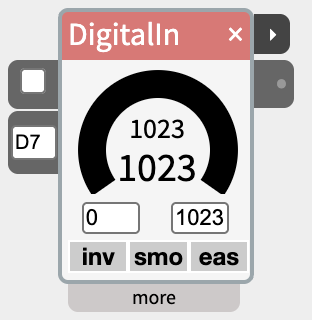
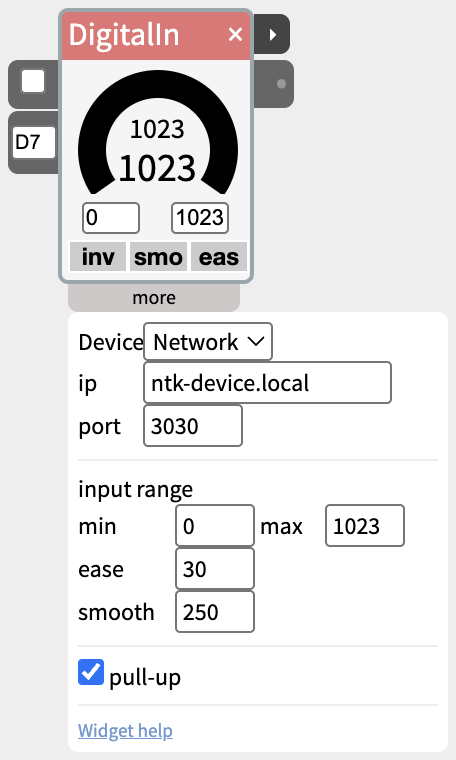

# DigitalIn

Read a sensor value from a digital input.

DigitalIn gets values from the digital input ports of a device (where an on/off sensor is attached), and allows the user to process those values before sending them to the next widget. By default, the range of values is 0-1023. But by changing the min and max values in the widget, the sensor values can be scaled to a different range.

The values can also be inverted (e.g. 1023-0), smoothed out to get rid of noise in the values, and given easing to make changes in values seem to have momentum and be more natural.

## Contents

- [The next port](#The-next-port)
- [Pull-up](#Pull-up)

## The next port

The small ▸ port on the right of the title bar sends a single pulse each time the input turns on: 1023 for a fifth of a second, then 0, and it flashes amber. Wire it into the **trigger** of a Scene, SpeechOut, Audio, Video, Sequence or LLM, and one press of a button starts it.

The body's outlet is still the one to use for anything that follows the input itself - an LED that lights while the button is held, Audio's **Play** while held, or a Gate or Boolean. Use next when a press should start something and let it run to its end.

- "Turns on" means the output rises past the middle of its range, so next follows the min and max you set, and smoothing.
- With **inv** on, the output is flipped, so next fires when the input turns off - on a button's release.
- Loading a patch with the input already on doesn't send a pulse.

Turn the widget's dial past halfway to try it without hardware.

## Pull-up

The **pull-up** checkbox in the widget's more panel depends on how your sensor is connected. It is on by default.

**On** - for a plain button or switch wired between the pin and **GND**, such as a rotary encoder's push switch (the **SW** pin on a KY-040 module). The board turns on the pin's pull-up resistor, so the pin sits high until the button pulls it low. The widget flips the reading, so pressed still reads high (on).

**Off** - for anything that sends its own on/off signal, and for a button wired between the pin and **3.3V**. This includes most Grove and breakout modules with their own chip: touch sensors (TTP223), PIR motion sensors, tilt and vibration modules, and Grove buttons. These drive the pin high when active and low otherwise, so leaving pull-up on makes them read backwards - on when untouched, off when touched.

**Reads backwards?** If the widget shows on while nothing is happening and off when the sensor is triggered, untick pull-up.

Patches saved before NTK 2026.12.0 also get pull-up turned on when they load, so a DigitalIn with a self-driving sensor or a button wired to 3.3V needs it unticked once.
