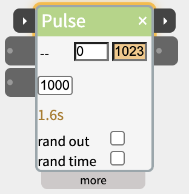
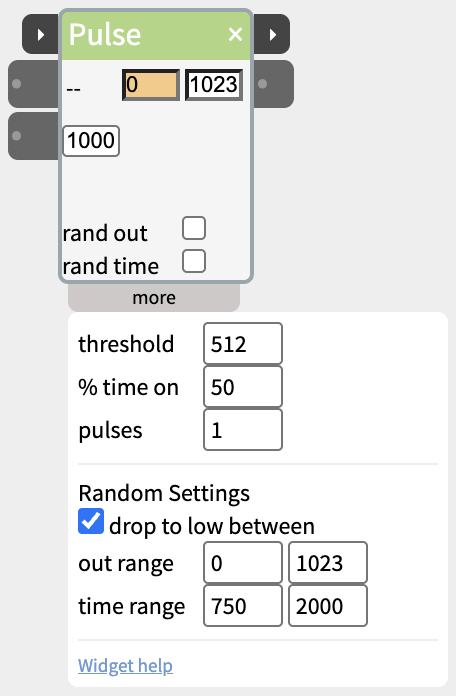

# Pulse

Switch a value between low and high on a steady beat - a blinking LED, a ticking motor, a regular "now" for other widgets - or wait a set time between two steps.



Each pulse is one cycle of **time** milliseconds: the output goes to the high value, stays there for part of the cycle (half, by default), then drops to the low value for the rest. Pulse can keep doing that for as long as it's told to, or play a set number of pulses when it's triggered and then tell the next widget it has finished.

## Contents

- [Three ways to run](#Three-ways-to-run)
- [Trigger and next](#Trigger-and-next)
- [Waiting between steps](#Waiting-between-steps)
- [Inlets and outlets](#Inlets-and-outlets)
- [Settings in the more panel](#Settings-in-the-more-panel)
- [Notes](#Notes)

## Three ways to run

- **Nothing wired in** - Pulse runs all the time, from the moment it's added. Wire its out1 into an LED and it blinks.
- **in** (the first input in the body) - pulses while its value is above the threshold, and stops at the low value when it drops below. Use this for "blink while someone is near".
- **trigger** (on the title bar) - plays a set number of pulses - one, unless you change **pulses** in the more panel - when its value rises past the threshold, then sends next. Once something is wired to trigger, Pulse no longer runs on its own: it waits to be triggered. A cable on in still works as above.

## Trigger and next

The two small ▸ ports on the title bar chain a Pulse with other steps:

- **trigger** (left) - the first pulse goes high at once; each one lasts **time** milliseconds, so three pulses of 500 take a second and a half. A trigger that arrives while the pulses are playing starts them again from the first.
- **next** (right) - when the last pulse's cycle ends, sends 1023 for a fifth of a second, then 0, and flashes amber.

The title bar glows amber while triggered pulses play, and the body counts down the time left until next, under the time box. Wire **next** into the **trigger** of the following step. See [Chaining Widgets - Trigger and Next](https://www.netlabtoolkit.org/chaining-widgets/) for more examples.

## Waiting between steps

Pulse with trigger is also a timer. Leave out1 unwired, set **time** to how long to wait, and put the Pulse between two steps:

```
SpeechOut ─next→ trigger─ Pulse (time 2000) ─next→ trigger─ Scene
```

The scene starts two seconds after the speech ends. With **rand time** on, the wait is a different length each time, between the two values of **time range** - good for a creature that pauses for a moment before it reacts.

To blink an LED three times and then carry on, set **pulses** to 3, wire out1 to the LED and next to the following step.

## Inlets and outlets

- **trigger** - on the title bar (see above).
- **in** - pulses while held above the threshold.
- **pulseLength** - sets **time** from another widget.
- **out1** - the low or high value.
- **next** - on the title bar (see above).

## Settings in the more panel



In the body:

- **low** and **high** (the two boxes on the right) - the two values the output switches between. The one the output is at is highlighted.
- **time** (the box on the left) - the length of one pulse cycle in milliseconds. Under it, while triggered pulses play, the seconds left until next.
- **rand out** - each pulse goes to a random value in **out range** instead of the high value.
- **rand time** - each cycle is a random length in **time range** instead of **time**.

In the more panel:

- **threshold** - the level in and trigger have to rise past (512 by default).
- **% time on** - how much of each cycle the output stays high (50 by default).
- **pulses** - how many pulses trigger plays before next (1 by default).
- **drop to low between** - with rand out on: ticked (the default), the output drops back to low between random values, so it still blinks; unticked, it steps straight from one random value to the next once per cycle - a light that flickers to a new level, a servo that wanders - and stays at its last value when in drops.
- **out range** and **time range** - the ranges for rand out and rand time.

## Notes

- Running on its own or from in, the first pulse comes at the end of the first cycle; from trigger, it comes at once.
- Pulse runs on the board in standalone patches, including trigger, next and pulses.
- To try a trigger without hardware, wire a [Button](https://www.netlabtoolkit.org/documentation/widgets/button/)'s next into it.
