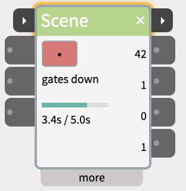
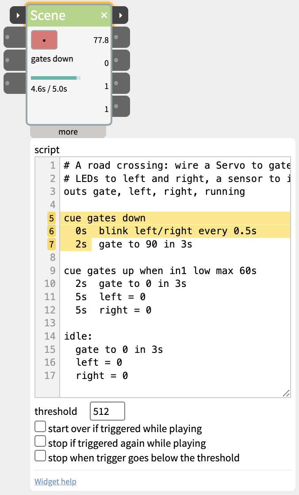

# Scene

Play a little story across up to four outputs, written as a short script.



A Scene plays a sequence of things over time - a road crossing whose lights flash and gates come down until the train has passed, a welding light flickering on a model building site, a shop-window display - as one readable script instead of a tangle of Pulse, Gate and Sequence widgets. The script is written in cues, like a theatre lighting desk: each cue starts on an event (play, a sensor, or a time), and every line inside a cue has its own time, counted from the start of that cue.

## Contents

- [Trying it](#Trying-it)
- [The road crossing example](#The-road-crossing-example)
- [Cues](#Cues)
- [Lines inside a cue](#Lines-inside-a-cue)
- [The idle section](#The-idle-section)
- [Trigger and next](#Trigger-and-next)
- [Inlets and outlets](#Inlets-and-outlets)
- [Settings in the more panel](#Settings-in-the-more-panel)
- [The workers example](#The-workers-example)
- [Notes](#Notes)

## Trying it

A new Scene already contains a working road-crossing script. Click **▶** to play it and **■** to stop; you can watch it with nothing wired in. When a cue is waiting for a sensor, the status flashes what it's waiting for (`wait in1 low`) - **click it to start the cue by hand**, as if the sensor had fired.

Then wire the outlets to a Servo, LEDs (DigitalOut or AnalogOut), a NeoPixel or a Display, and a sensor or button into **in1**.

## The road crossing example

```
outs gate, left, right, running

cue gates down
  0s  blink left/right every 0.5s
  2s  gate to 90 in 3s

cue gates up when in1 low max 60s
  2s  gate to 0 in 3s
  5s  left = 0
  5s  right = 0

idle:
  gate to 0 in 3s
  left = 0
  right = 0
```

- **`outs`** names the four outlets, so the script can say `gate` instead of `out1`. The outlet named `running` sends 1 while the scene plays.
- **`cue gates down`** starts on play: the crossing lights blink in turn from 0 s, and at 2 s the gate moves to 90 over 3 s.
- **`cue gates up`** waits until `in1` is low - the train has cleared - or 60 s at most, so a broken sensor can't hold the gates down forever. Then the gate rises, and the lights go off once it's up.

## Cues

A cue line is `cue` and a name, which shows in the widget while the cue plays. Names can have spaces, but must be unique and can't contain `when`, `after` or `loop`.

| Cue line | The cue starts |
|---|---|
| `cue NAME` | On play, if it's the first cue; otherwise as soon as the cue before it has finished. |
| `cue NAME after 2s` | 2 s after the cue before it has finished. |
| `cue NAME after 2s..6s` | After a random time between 2 and 6 s, different each time. |
| `cue NAME when in1 high` | When the cue before it has finished and `in1` is above the threshold (`low`: below it) - straight away if it already is. |
| `cue NAME when in1 low max 60s` | The same, but starts anyway after 60 s. |
| `cue NAME when in1 rises` | When `in1` goes up past the threshold while this cue waits - a button press, or another widget's next pulse. A press during the cue before doesn't count, and neither does `in1` being high already. `falls`: when it comes back down. `max` works here too. |

`high` and `low` are levels: they suit a sensor that stays on while something is there, like a train on the crossing. `rises` and `falls` are moments: they suit a press or a pulse, which is over in a fraction of a second.

| Repeating | Does |
|---|---|
| `loop` at the end of a cue line | Plays the cue again each time it finishes, until the scene is stopped. |
| `loop 3 times` | Plays the cue 3 times, then goes on. |
| `loop until in1 high` | After each round, goes on if `in1` is high (or `low`); otherwise plays it again. |
| `repeat` on a line after the last cue | Goes back to the first cue. `repeat from NAME` goes back to the named cue. |

A cue has finished when its last line has happened and its last move has arrived; a blink without `for` doesn't count. After the last cue (with no `repeat`), the scene ends: outlets keep their values and blinks stop.

## Lines inside a cue

Each line is a time and an action: `2s  gate to 90 in 3s`. The time counts from the start of the cue (leave it out for `0s`), and lines don't wait for each other.

| Action | Does |
|---|---|
| `NAME = VALUE` | Sets an outlet to a number, or to text in quotes (`sign = "CLOSED"`, for a Display). |
| `NAME to VALUE in TIME` | Moves an outlet smoothly from where it is to VALUE over TIME. Add an easing for a more natural movement: `crew to 30 in 2s ease sine` (the same easings as Tween). |
| `blink NAME every TIME` | Flips the outlet between 1 and 0. `blink left/right every 0.5s` alternates two outlets. Add `between 0 and 255` for an LED on AnalogOut, and `for 2s` to stop by itself. |
| `wait TIME` | Does nothing for TIME - used with `then`, below. |

**`then`** starts a line when the line above it ends, so you don't have to work out its time: `then lamp to 255 in 2s`, or with a gap, `then 0.5s gate to 0 in 1s`. A pause between two moves is `then wait 1s`.

- **Times always need a unit:** `2s`, `1.5s`, `500ms`.
- **Outlets** are the names from the `outs` line, or `out1` to `out4`. A new set, move or blink on an outlet replaces whatever was running on it; to start one after another, use `then`.
- Lines run in time order, whatever order they're written in. `#` starts a comment; indenting is only for reading.

## The idle section

The lines after `idle:` say how the scene looks when it isn't playing. When the patch opens, they're applied **instantly**, so a servo starts where the scene expects it. When the scene is stopped, they're **played**: the crossing's gate goes back up over 3 s rather than with a jerk. With no idle section, stopping freezes the outlets where they are.

## Trigger and next

The two small ▸ ports on the title bar chain a Scene with other steps:

- **trigger** (left) - plays the scene from its first cue when its value rises above the threshold. Anything that sends 1023 can start it, including another widget's next.
- **next** (right) - when the scene stops playing, sends 1023 for a fifth of a second, then 0, and flashes amber. It fires when the last cue finishes, or when the scene is stopped (the stop inlet, the ■ button, or trigger going low with that option on). A stopped scene plays its idle lines first, and next waits for them, so the next step starts once everything is back at rest. With no idle section, next fires as soon as it stops. A scene with `repeat` never finishes, so it only sends next when stopped.

While the scene plays, the title bar glows amber - including while a stopped scene plays its idle lines, until next fires.

Wire **next** into the **trigger** of the following step - a second Scene, a SpeechOut, an Audio clip - and it begins exactly when this scene ends, however long its cues waited for their sensors.

## Inlets and outlets

- **trigger** - on the title bar (see above). **stop** - stops the scene, playing the idle lines.
- **in1**, **in2** - read by `when`, `max` and `loop until`. Unwired, a `when` cue waits; click the flashing status to start it.
- **out1-out4** - named by the `outs` line (hover over an outlet to see its name). An outlet named `running` sends 1 while the scene plays and 0 otherwise - to keep something on for as long as the scene runs. To start something when the scene ends, use next.
- **next** - on the title bar (see above).

## Settings in the more panel



- **script** - checked as you type: a mistake is marked red in the line numbers and explained under the box; click it to go to that line. While the scene plays, the running lines are highlighted. The script takes effect when you click out of the box.
- **threshold** - the level above which trigger, stop, in1 and in2 count as high (default 512).
- **start over if triggered while playing** - otherwise a new trigger is ignored until the scene has finished.
- **stop if triggered again while playing** - press once to start, again to stop. The scene plays its idle lines, then sends next. Use this one with a trigger that comes as a short pulse, such as DigitalIn's next; the option below needs trigger held high. Only one of these first two can be on.
- **stop when trigger goes below the threshold** - the scene plays only while trigger is held high, e.g. a button held down.

## The workers example

```
outs arm, weld, crew

cue walk over
  0s     crew to 30 in 2s ease sine     # a worker walks over

cue work
  0s     arm to 120 in 1s
  1s     blink weld every 80ms for 2s
  3s     arm to 40 in 1.5s

cue step back after 2s..6s              # a pause, different each time
  0s     crew to 10 in 1s
  1.5s   crew to 30 in 1s

repeat from work

idle:
  arm = 40
  weld = 0
  crew = 0
```

The worker walks over once; then the arm swings, the welding light flickers, and after a random pause the worker steps back - over and over from `work` until stopped.

## Notes

- **Nothing happens when I click play** - look for "script error" in the widget and red line numbers in the more panel.
- **A cue never starts** - the flashing status shows what it's waiting for. Check the sensor and the threshold.
- **A servo jumps when the patch opens** - add its starting position to `idle:`.
- Scene also runs in a patch pushed to the board.
