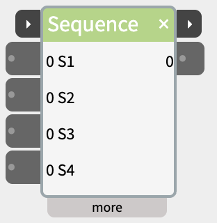
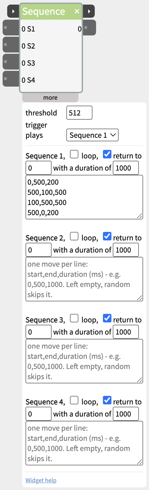

# Sequence

Play a series of moves on one output - a servo sweep, an LED fading up and down - started by a sensor, a button or another widget.



A Sequence holds up to four short behaviours, each a list of moves: go from one value to another over a time. Each behaviour has its own input, so different sensors can trigger different movements on the same output - and the trigger port can play one of them, or one at random, whenever another widget says so.

## Contents

- [Writing a sequence](#Writing-a-sequence)
- [Two ways to play](#Two-ways-to-play)
- [Trigger and next](#Trigger-and-next)
- [Inlets and outlets](#Inlets-and-outlets)
- [Settings in the more panel](#Settings-in-the-more-panel)
- [Notes](#Notes)

## Writing a sequence

Open the more panel and write one move per line as **start,end,duration**, with the duration in milliseconds:

```
0,500,200
500,100,500
100,500,500
500,0,200
```

This goes from 0 to 500 in 0.2 s, down to 100 in half a second, back up to 500, then to 0. The output changes smoothly through each move.

A new Sequence has moves only in Sequence 1; Sequences 2 to 4 are empty, ready for other behaviours. An empty sequence is ignored completely: its input does nothing, and random never picks it.

## Two ways to play

- **in1 to in4** (the inputs in the body) - each plays its own sequence (S1 to S4) while its value is held above the threshold. When it drops below before the sequence has finished, the sequence is cancelled - and with **return to** ticked, the output moves back to the return value over the time given. Use these for "move while the button is held".
- **trigger** (on the title bar) - plays the sequence chosen in **trigger plays** when its value rises past the threshold, and keeps playing to the end when it drops again. Use this for "play the whole behaviour when this happens", including starting from another widget's next pulse.

## Trigger and next

The two small ▸ ports on the title bar chain a Sequence with other steps:

- **trigger** (left) - plays the sequence chosen in **trigger plays**: Sequence 1 to 4, or **random** - one of the sequences with moves in it, picked at random each time and never the one that played last. With four behaviours written, random keeps a robot or a display from repeating itself. With only one sequence filled in, random plays that one every time.
- **next** (right) - when a sequence without loop plays its last move, sends 1023 for a fifth of a second, then 0, and flashes amber - whichever input started it. A cancelled sequence, the move back to the return value, and a looping sequence don't send it.

The title bar glows amber while a sequence plays. Wire **next** into the **trigger** of the following step - a [Scene](https://www.netlabtoolkit.org/documentation/widgets/scene/), a [SpeechOut](https://www.netlabtoolkit.org/documentation/widgets/speechout/), or the Sequence's own trigger to play another random behaviour.

## Inlets and outlets

- **trigger** - on the title bar (see above).
- **in1** to **in4** - play Sequences 1 to 4 while held high.
- **out1** - the moving value.
- **next** - on the title bar (see above).

## Settings in the more panel



- **threshold** - the level the inputs have to rise past (512 by default).
- **trigger plays** - which sequence the trigger port plays, or random.
- For each sequence:
  - **loop** - plays it again from the top each time it finishes, for as long as its input is held (or forever, from start). Off by default, since a looping sequence never sends next.
  - **return to** and **with a duration of** - when a held input is let go before the end, the output moves back to this value over this many milliseconds.
  - The moves, one per line.

## Notes

- Sequence runs on the board in standalone patches, including trigger, next and random.
- To try a sequence without hardware, wire a [Button](https://www.netlabtoolkit.org/documentation/widgets/button/)'s next into trigger, or its out into in1.
