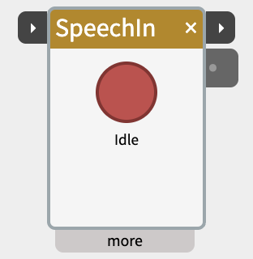
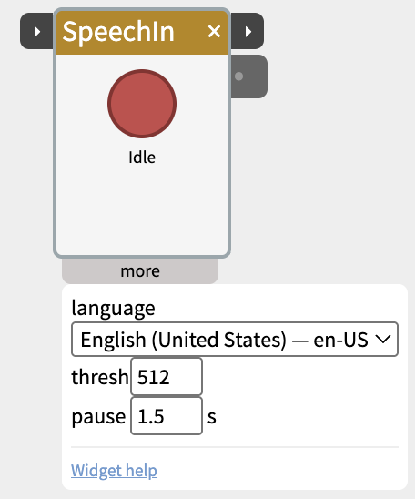

# SpeechIn

The SpeechIn widget turns speech into text. Talk into your computer's microphone and the words come out the outlet as a string, ready to feed any text-using widget (Text, SpeechOut, LLM, Decide and others).

On **macOS** it uses Apple's built-in speech recognition, which runs **on-device** — no internet, no account, no API key, no time limit, and your audio never leaves your machine. On Windows/Linux the widget shows "not available" (a cross-platform option is planned).

## Contents

- [How it works](#How-it-works)
- [Start and done](#Start-and-done)
- [First use](#First-use)
- [Settings in the more panel](#Settings-in-the-more-panel)
- [Notes](#Notes)
- [Example patches](#Example-patches)

## How it works

- **Hold the round record button and speak.** Words appear in the widget as you talk (a live preview), and the finished text is sent out the **text** outlet when you release the button.
- **Or click the button once and speak.** It listens until you pause, then sends the text.
- The record button pulses red while recording, and the title bar glows amber while it listens. The status line shows `recording`, then `transcribing`, then back to `idle`.
- The outlet **keeps its last result** — downstream widgets don't get blanked when you stop without speaking.

## Start and done

The two small ▸ ports on the title bar let other widgets and hardware start SpeechIn, and let SpeechIn start the next step:

- **start** (left) — starts listening when its value rises past the **threshold** (default 512). It works like the record button:
  - **Held high** (a button wired through DigitalIn), it listens until start goes low again, then sends the text.
  - **A short pulse** (another widget's **done**, a Pulse, an IfThen), it listens until you pause for **pause** seconds, then sends the text.
  - If nothing is said within 10 seconds, it stops listening and sends nothing.
- **done** (right) — when a transcript with words arrives, sends 1023 for a fifth of a second, then 0, just after the **text** outlet changes. It flashes amber as it does. Listening that heard nothing doesn't fire it.

Wire **SpeechOut's done** into **SpeechIn's start**, and SpeechIn listens for an answer as soon as SpeechOut has finished asking — so it never hears SpeechOut itself.

## First use

The first time you record, macOS asks for **Microphone** and **Speech Recognition** permission. Both are required. If you decline, the widget shows an error; you can re-enable them later in **System Settings → Privacy & Security**.

## Settings in the more panel

- **language** — the language you'll be speaking. The list has a **Common** group (English, Spanish, French, German, Italian, Portuguese, Japanese, Chinese, Korean, Russian, Arabic, Hindi) and an **All other languages** group with everything else Apple supports (~60 languages total). If a language isn't in the list, Apple's recognizer doesn't support it.
- **threshold** — the level on the **start** port (0–1023) that starts listening.
- **pause** — when start isn't held (a pulse, or a click on the button), how long a pause in seconds ends listening (default 1.5). Raise it for slow, thoughtful speakers.

## Notes

- **On-device vs. server:** for most listed languages recognition runs entirely on your Mac. For a few, if the offline language model isn't installed, macOS falls back to Apple's servers — which needs internet and caps each utterance at about a minute. You can add offline languages under **System Settings → Keyboard → Dictation**.
- **Accuracy** depends on your microphone and background noise, same as any dictation. A headset mic in a quiet room is best; a laptop mic across a noisy room is worst.
- **Patches saved before start and done existed** open with their cables in the right place: a cable to the old **trigger** inlet arrives at **start**, and the **text** outlet is where it was.

## Example patches

- **SpeechIn → SpeechOut** — repeat back what you said.
- **SpeechIn → Text** — show the transcription on the canvas.
- **Button → SpeechIn → LLM → SpeechOut** — a push-to-talk voice assistant.
- **A conversation loop** — SpeechIn's text → LLM → SpeechOut, and SpeechOut's done → SpeechIn's start. Click SpeechIn's button once to begin; after that it takes turns on its own.
