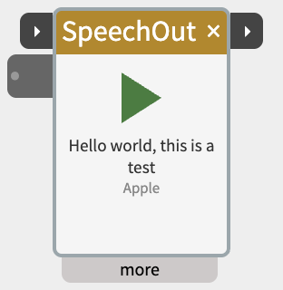
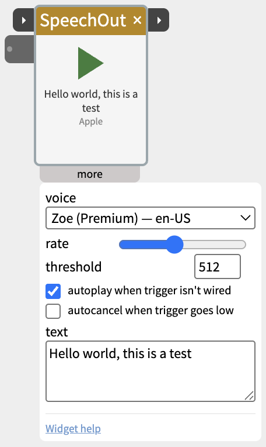

# SpeechOut

The SpeechOut widget speaks text out loud. Send it words (from a Text widget, a Keyboard, SpeechIn, an LLM, anything that produces a string) and it reads them through your computer's speakers.

On **macOS** it uses Apple's speech engine, which can use the high-quality neural ("Premium") voices — but **you have to download those voices yourself first** (see below). On Windows/Linux it uses the system's built-in speech synthesis.

## Contents

- [Download the good voices first on a Mac](#Download-the-good-voices-first-on-a-Mac)
- [How it works](#How-it-works)
- [Trigger and next](#Trigger-and-next)
- [Settings in the more panel](#Settings-in-the-more-panel)
- [Notes](#Notes)
- [Example patches](#Example-patches)

## Download the good voices first on a Mac

Out of the box, macOS only has the plain built-in voices (Samantha, Daniel, and friends). They sound robotic — "just okay". The good ones are a free download:

**System Settings → Accessibility → Spoken Content → System Voice →** the **ⓘ** button (or "Manage Voices…") **→** expand your language **→** download a voice marked **(Premium)** or **(Enhanced)**.

- **Premium** voices are neural — close to Siri quality. ~100–500 MB each.
- **Enhanced** voices are a step up from the built-in ones, smaller.
- Good English picks: **Zoe (Premium)**, **Ava (Premium)**.

Once downloaded, they appear in SpeechOut's **voice** menu under a **Premium** / **Enhanced** heading, and the widget defaults to a Premium voice automatically. Until you download at least one, the widget notes "Tip: download Premium voices in System Settings" and you're stuck with the basic voices.

(This only applies to the Mac path. On Windows the good "Natural" voices are already available, so there's nothing to download.)

## How it works

- Type text into the field in the "more" panel, or wire a string into the **text** inlet.
- **Click the play triangle** to speak it. The triangle becomes a pulsing red square while speaking — click again to stop.
- Or start it from another widget or from hardware: a value rising past the **threshold** on the **trigger** port (the small ▸ on the left of the title bar) starts playback.
- With **autoplay** on (the default), SpeechOut speaks automatically whenever the text inlet changes — so `SpeechIn → SpeechOut` just works with nothing to click. Once something is wired to **trigger**, autoplay is off and trigger alone says when to speak.
- While it speaks, the title bar glows amber.

## Trigger and next

The two small ▸ ports on the title bar chain SpeechOut with other steps:

- **trigger** (left) — speaks when its value rises past the **threshold** (default 512). Anything that sends 1023, such as a button through DigitalIn, IfThen or Pulse, can start it.
- **next** (right) — when speaking ends, sends 1023 for a fifth of a second, then 0. It flashes amber as it does. It fires whether the speech finished, was stopped, or failed.

Wire **next** into the **trigger** of the following step, and that step begins exactly when the speech ends, however long the sentence was. For example, wire next into a Scene's trigger to play a light sequence after an announcement, or into a second SpeechOut's trigger to say the next line.

## Settings in the more panel

- **voice** — grouped **Premium → Enhanced → Default**. English voices are listed first. On Windows/Linux this lists the system's voices instead.
- **rate** — how fast it talks. Middle is normal.
- **threshold** — the level on the **trigger** port (0–1023) that starts playback.
- **autoplay when trigger isn't wired** — speak whenever the text inlet changes (on by default). With something wired to **trigger**, only trigger makes it speak - so wiring both SpeechIn's text and its next into SpeechOut says each phrase once, when the transcript is ready.
- **autocancel when trigger goes low** — when the trigger port drops back below the threshold, stop any speech in progress.
- **text** — the words to speak. The text inlet writes here too.

## Notes

- The small grey word in the widget body (`apple` or `web`) tells you which engine is running.
- A patch saved on a Mac with a Premium voice, opened on a machine that doesn't have that voice, falls back to a default voice rather than going silent.

- **Bluetooth headphones can clip the first word or two** right after SpeechIn has been listening: macOS switches the headphones out of call mode when the microphone closes, which takes about a second, and speech during the switch is lost. The Mac's speakers or wired headphones don't have this problem.

## Example patches

- **Text → SpeechOut** — read a fixed message when trigger goes high.
- **SpeechIn → SpeechOut** — echo speech back.
- **AnalogIn → SpeechOut** (with a Text/Process widget building the string) — announce a sensor value.
- **SpeechOut next → Scene trigger** — play a light sequence as soon as an announcement ends.
