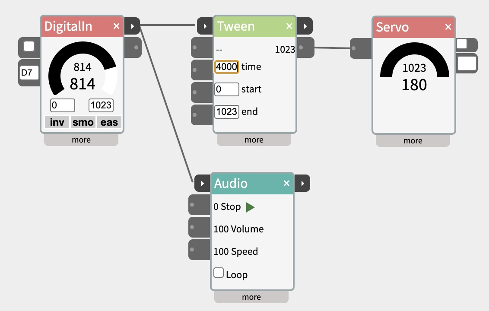

# Chaining Widgets - Trigger and Next

Chain widgets so that each step begins when the one before it has finished - however long that takes.

Many things in a prototype take a time you can't know in advance: a sentence being spoken, an AI writing its reply, someone talking, a sound or a video playing to its end, a scene of lights and motors. Widgets that do these things have two small ▸ ports on their title bar. **trigger**, on the left, begins the widget's action. **next**, on the right, sends a short pulse when it has finished. Wire one widget's next into the following widget's trigger, and the steps run in turn - no guessing at delays, and nothing breaks when one step gets longer.

## Contents

- [How it works](#How-it-works)
- [Which widgets have trigger and next](#Which-widgets-have-trigger-and-next)
- [Seeing what is happening](#Seeing-what-is-happening)
- [Held values and pulses](#Held-values-and-pulses)
- [Example patches](#Example-patches)
- [Trying a chain without hardware](#Trying-a-chain-without-hardware)
- [Standalone patches](#Standalone-patches)

## How it works



One press of a button on D7 triggers both the Tween and the Audio: the servo swings over in four seconds while the sound plays.

There's no special kind of cable: trigger and next use ordinary values, like everything else in NTK.

- **trigger** acts when its value **rises past the threshold** - 512 by default, set in each widget's more panel. It acts on the rise, not the level, so a value that stays high starts the widget once, not over and over.
- **next** sends **1023 for a fifth of a second**, then goes back to 0. That's a pulse: a moment, not a state.

So a next pulse can trigger anything that has a threshold - not just the widgets with trigger ports, but IfThen, Count, Gate, a DigitalOut LED as a "finished" blink. And anything that sends 1023 can start a widget: a button, a sensor going high, a Pulse.

Wire one next into two triggers and both run at once.

## Which widgets have trigger and next

| Widget | trigger | next |
|---|---|---|
| [SpeechOut](https://www.netlabtoolkit.org/documentation/widgets/speechout/) | speaks the text | finished speaking |
| [SpeechIn](https://www.netlabtoolkit.org/documentation/widgets/speechin/) | listens - while held, or until a pause after a pulse | a transcript arrived |
| [LLM](https://www.netlabtoolkit.org/documentation/widgets/llm/) | sends the prompt again | the reply arrived |
| [Decide](https://www.netlabtoolkit.org/documentation/widgets/decide/) | decides on the current text | the answers arrived |
| [Scene](https://www.netlabtoolkit.org/documentation/widgets/scene/) | plays from the first cue | the last cue finished, or it was stopped and its idle lines have played |
| [Audio](https://www.netlabtoolkit.org/documentation/widgets/audio/) | plays from the beginning | the clip played to its end |
| [Video](https://www.netlabtoolkit.org/documentation/widgets/video/) | plays from the beginning | the video played to its end |
| [Sequence](https://www.netlabtoolkit.org/documentation/widgets/sequence/) | plays the sequence chosen in "trigger plays" - one of four, or one at random | a sequence without loop played its last move |
| [Tween](https://www.netlabtoolkit.org/documentation/widgets/tween/) | moves from start to end | the move reached its end value |
| [Pulse](https://www.netlabtoolkit.org/documentation/widgets/pulse/) | plays a set number of pulses - one by default | the last pulse's cycle ended - so it can also be a wait between steps |
| [Count](https://www.netlabtoolkit.org/documentation/widgets/count/) | counts one | the count reached max |
| [DigitalIn](https://www.netlabtoolkit.org/documentation/widgets/digitalin/) | - | the input turned on: one pulse per press |
| [Button](https://www.netlabtoolkit.org/documentation/widgets/button/) | - | one pulse per click |

A looping clip, sequence, tween or scene never finishes, so it only sends next when stopped (Scene) or not at all.

## Seeing what is happening

- The **title bar glows amber** while a widget is running - between its trigger and its next.
- The **next port flashes amber** when it sends its pulse.
- Scene shows which cue it's on and what it's waiting for; SpeechIn says **wait…**, **speak now**, **transcribing**.

A chain that has stalled shows it: one widget glowing that should have finished, or none glowing at all.

## Held values and pulses

Some inputs are **levels** - a value that stays high while something is true: a button held down, someone standing in front of a sensor, a train on the crossing. Others are **moments** - a pulse that's over in a fraction of a second: a next pulse, or DigitalIn's and Button's next on each press.

Most widgets have a way to use each:

- **Audio and Video**: **Play** (in the body) plays while held high; **trigger** plays the whole clip from one pulse.
- **Sequence**: **in1 to in4** play while held; **trigger** plays the whole sequence from one pulse.
- **Tween**: **in** plays while held; **trigger** makes the whole move from one pulse.
- **Pulse**: **in** pulses while held; **trigger** plays a set number of pulses from one pulse.
- **Scene**: **stop when trigger goes below the threshold** makes it play only while trigger is held - use it with a held value, not a pulse, or the scene stops a fifth of a second after it starts. With a pulse, use **stop if triggered again while playing** instead: press once to start, again to stop.
- **Scene cues**: `when in1 high` and `when in1 low` wait for a level, and are true straight away if it already is. `when in1 rises` and `when in1 falls` wait for a moment that happens while the cue waits - a press or a next pulse.
- **DigitalIn and Button**: **out** is the level (high while pressed); **next** is the moment (one pulse per press).

## Example patches

### Press a button play a sound

```
DigitalIn ─next→ trigger─ Audio
```

A button on the board plays a clip from the beginning, once per press, all the way through - even if the button is let go at once. Use DigitalIn's body outlet into Audio's **Play** instead to play only while the button is held.

### A conversation

```
SpeechIn ─text→ prompt─ LLM ─text→ text─ SpeechOut
   ↑                                          │
   └──────────── trigger ←─next───────────────┘
```

SpeechIn hears a question, the LLM answers it, SpeechOut says the answer - and when it has finished speaking, its next pulse sets SpeechIn listening again. Wired this way they take turns: the microphone isn't open while the computer is talking. Start the first round by clicking SpeechIn's record button.

To have the LLM send only when the transcript is complete, also wire SpeechIn's next into the LLM's trigger.

### A show in steps

```
Button ─next→ trigger─ Scene "doors open" ─next→ trigger─ Audio "fanfare" ─next→ trigger─ Scene "lights"
```

One click runs the whole show in order: the doors open (however long the motors take), then the fanfare plays to its end, then the light scene runs. Change the length of any step and the rest still follow it.

### A pause between steps

```
SpeechOut ─next→ trigger─ Pulse (time 2000) ─next→ trigger─ Scene
```

The scene starts two seconds after the speech ends. A Pulse with nothing wired to its out1 is a timer: **time** sets how long it waits. Turn on **rand time** for a pause that's a little different each time.

### Every third visitor

```
DigitalIn (PIR sensor) ─next→ in1─ Count (min 1, max 3) ─next→ trigger─ Video
```

A motion sensor counts people walking past; every third one gets the video. Count's next fires each time the count reaches 3, and the following count goes back to 1.

### A creature with moods

```
DigitalIn ─next→ trigger─ Sequence (trigger plays: random) ─out1→ Servo
                             │
                             └─next→ trigger─ Audio
```

Write four different movements in Sequences 1 to 4. Each touch plays one of them at random - never the same one twice in a row - and when the movement is over, a sound plays. Wire the Sequence's next back into its own trigger as well, and it keeps choosing new moves by itself: each one starts as the last one ends.

### A crossing with a sensor

```
Button ─next→ trigger──────────────┐
                                   Scene ─out1→ Servo (gate)
DigitalIn (train sensor) ─out→ in1─┘
```

The road-crossing script that comes with Scene lowers the gate, then waits in `cue gates up when in1 low` until the sensor reports the train has gone. The sensor's **out** is a level, so it's wired into in1, and the cue waits for it to drop.

With a second button instead of a sensor, write the cue as `cue gates up when in1 rises` and wire that button's **next** into in1: one press lowers the gates, the second raises them.

### Waiting for two things

```
Audio ─next→ in1─┐
                 Count (min 1, max 2) ─next→ trigger─ Scene
Video ─next→ in2─┘
```

Run a sound and a video at the same time, and start the scene only when both have finished. Each next pulse counts one; the count reaches 2 when the second one finishes, and the following round starts again from 1. If one of them could finish twice in a round, also wire whatever started them into Count's **reset** input, so each round counts from scratch.

## Trying a chain without hardware

- A [Button](https://www.netlabtoolkit.org/documentation/widgets/button/)'s next stands in for any press or next pulse - put one at the start of a chain, and later swap it for a DigitalIn with the same cables.
- Scene, Audio and Video have their own ▶ buttons, and SpeechOut and SpeechIn have speak and record buttons, so each step can be tried on its own.
- A Scene cue waiting for a sensor can be started by hand: click the flashing status.

## Standalone patches

A patch pushed to the board keeps working there: **Scene**, **Sequence**, **Tween**, **Pulse**, **Count** and **DigitalIn** run their trigger and next ports on the board itself, with no computer attached. Speech, LLM, Audio and Video need NTK running.

In monitor mode, the board reports its values a few times a second, so a next pulse's fifth-of-a-second flash isn't always shown - the board still sends the pulse.
