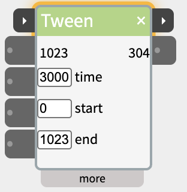
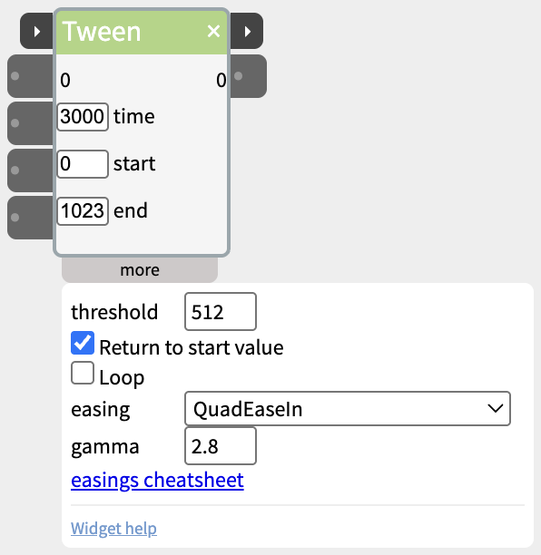

# Tween

Move a value smoothly from a start value to an end value over a set time - an LED fading up, a servo swinging over - with a choice of easing curves.

Tween makes one move: from **start** to **end** in **time** milliseconds. The easing curve in the more panel sets how it gets there - steady, speeding up, slowing down, overshooting, or bouncing. For a series of moves, use a [Sequence](https://www.netlabtoolkit.org/documentation/widgets/sequence/) instead.

## Contents

- [Two ways to play](#Two-ways-to-play)
- [Trigger and next](#Trigger-and-next)
- [Inlets and outlets](#Inlets-and-outlets)
- [Settings in the more panel](#Settings-in-the-more-panel)
- [Notes](#Notes)

## Two ways to play

- **in** (the first input in the body) - plays from start to end while its value is held above the threshold. When it drops below before the end, the tween stops - and with **Return to start value** ticked, the output moves back to the start value. Use this for "move while the button is held" or "open while someone is near".
- **trigger** (on the title bar) - plays from start to end when its value rises past the threshold, and keeps playing to the end when it drops again. Use this for "make the whole move when this happens", including starting from another widget's next pulse.

## Trigger and next

The two small ▸ ports on the title bar chain a Tween with other steps:

- **trigger** (left) - plays from the start value to the end value, as above. A trigger that arrives while the tween is playing starts it again from the start value.
- **next** (right) - when the tween reaches its end value, sends 1023 for a fifth of a second, then 0, and flashes amber - whichever input started it. A tween cut short, the move back to the start value, and a looping tween don't send it.

The title bar glows amber while the tween plays. Wire **next** into the **trigger** of the following step - a second Tween to move back the other way, a [Scene](https://www.netlabtoolkit.org/documentation/widgets/scene/), an [Audio](https://www.netlabtoolkit.org/documentation/widgets/audio/) clip - and it begins as soon as the move has finished. See [Chaining Widgets - Trigger and Next](https://www.netlabtoolkit.org/documentation/widgets/trigger-and-next/) for more examples.

## Inlets and outlets

- **trigger** - on the title bar (see above).
- **in** - plays while held above the threshold.
- **Duration**, **Start**, **End** - set the time, start and end values from another widget, the same as typing them into the body.
- **out1** - the moving value.
- **next** - on the title bar (see above).

## Settings in the more panel

- **threshold** - the level in and trigger have to rise past (512 by default).
- **Return to start value** - when in drops before the end, move back to the start value over the same time. On by default.
- **Loop** - plays again from the start each time it reaches the end, for as long as in is held, or from a single trigger. With nothing wired to in, a looping tween plays all the time. A looping tween never sends next.
- **easing** - the shape of the move. Ease in starts slowly, ease out finishes slowly, and ease in-out does both. Elastic, Back and Bounce overshoot or bounce at the ends. The **easings cheatsheet** link shows each curve.
- **gamma** - only for the Gamma curves, which make an LED's fade look even to the eye. 2.8 suits most LEDs.

## Notes

- Tween runs on the board in standalone patches, including trigger, next, loop and all the easing curves.
- To try a tween without hardware, wire a [Button](https://www.netlabtoolkit.org/documentation/widgets/button/)'s next into trigger, or its out into in.
