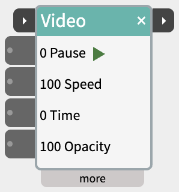
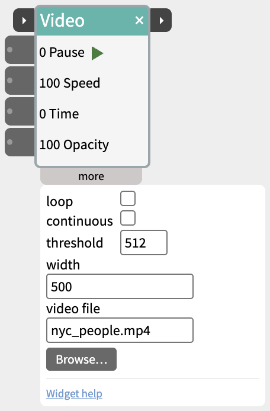

# Video

Play a video on the screen, started and stopped by a sensor, a button or another widget.

Video shows a video file in its own box on the canvas - one of the samples that come with NTK, or any file on your computer. It can play while an input is held high, play the whole clip through when it's started, jump to any point, fade in and out, and tell the next widget when it has finished.

## Contents

- [Trying it](#Trying-it)
- [Two ways to play](#Two-ways-to-play)
- [Trigger and next](#Trigger-and-next)
- [Inlets](#Inlets)
- [Settings in the more panel](#Settings-in-the-more-panel)
- [Notes](#Notes)

## Trying it

Click the small ▶ button next to **Play** to play the video, and again to pause it. Nothing needs to be wired in. The title bar glows amber while it plays. Drag the video itself to place it on the canvas.

## Two ways to play

- **Play** (the first input in the body) - plays while its value is above the threshold, and pauses when it drops below. Use this for "play while the button is held" or "play while someone is near".
- **trigger** (on the title bar) - plays from the beginning when its value rises past the threshold, and keeps playing to the end when it drops again. Use this for "play the whole clip when this happens", including starting from another widget's next pulse.

## Trigger and next

The two small ▸ ports on the title bar chain Video with other steps:

- **trigger** (left) - plays from the beginning, as above. A trigger that arrives while the video is already playing is ignored.
- **next** (right) - when the video plays to its end, sends 1023 for a fifth of a second, then 0, and flashes amber. With loop on the video never ends, so next never fires. Pausing it doesn't fire it either.

Wire **next** into the **trigger** of the following step - another Video, an [Audio](https://www.netlabtoolkit.org/documentation/widgets/audio/), a [Scene](https://www.netlabtoolkit.org/documentation/widgets/scene/) - and it begins as soon as the video has finished.

## Inlets

- **trigger** - on the title bar (see above).
- **Play** - plays while above the threshold.
- **Speed** - 100 is normal speed, 50 half speed, 200 double.
- **Time** - jumps to a point in the video: 0 is the start and 1023 the end, whatever its length. Wire a knob in to scrub through it.
- **Opacity** - 0 (invisible) to 100 (solid), for fading the video in and out.

## Settings in the more panel

- **loop** - starts again from the beginning each time it reaches the end.
- **continuous** - plays all the time, whatever Play is doing.
- **threshold** - the level Play and trigger have to rise past (512 by default).
- **width** - the video's width on the canvas, in pixels. The height follows its proportions.
- **video file** - one of the samples that come with NTK: `nyc_people.mp4` or `ball.mp4`.
- **Browse…** - pick a video file on your computer instead (MP4, MOV, M4V, WebM or OGV). Typing a sample name in **video file** switches back to it.

## Notes

- A file picked with Browse is saved in the patch as a path on your computer, so a patch shared with someone else needs the file at the same place.
