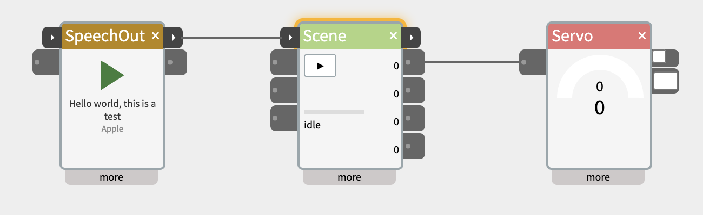

# Control flow: start/done and row-based widgets

**Status:** scoped 2026-11-05. Built so far: start/done header ports on SpeechOut, SpeechIn and LLM (2026-11-05; SpeechIn's start listens while held, or until a pause after a pulse), and on Scene, Audio, Video, Sequence and DigitalIn (done only) (2026-11-09; see the table below for what each does), with the shared header-port support in `WidgetMulti.js` (`header: true` ports, `bodyIns`/`bodyOuts`, saved patches keep the code's port list, old cables redrawn by `PatchLoader.js`).

Two ideas from Phil's [Delft AI Toolkit](https://github.com/pvanallen/delft-ai-toolkit/blob/master/docs/README.md) (Unity + a Raspberry Pi robot, 2018–2020), considered for NTK:

1. **Control flow**: a node runs, finishes, and hands control to the next node, which lights up while it runs. Delft mixed this (behaviour-tree style) with ordinary data flow in one graph.
2. **Row-based nodes**: one node holds a list of rows you add, reorder and delete. Delft's Action node ran its rows as a sequence; its Condition nodes held a list of tests, each with its own outlet. This kept Delft graphs small.

## What Delft had, and what NTK has today

| Delft | NTK today |
|---|---|
| **Action node**: rows of actions run in turn, with repeats and random | **Scene** says the same as a script (cues, `then`, `loop`, `after 2s..6s`). No row editor. |
| **Condition nodes**: rows of tests (starts with, contains, GT...), each with its own outlet; Otherwise, AllTrue and Not; the matching row lights up | **IfThen** has one test with true/false values and waits. **Decide** has one outlet per question. |
| **Control passing** from node to node, with the active node highlighted | None. NTK is data flow only; Scene's `start` inlet and `running` outlet are the nearest thing. |
| **Start, Splitter (sequential/random), Restart, Exit** | Splitter splits values, not control. |
| **SubGraph**: a graph as one node, with a required Start and Exit | The [Macro](macro-widget.md) plan, with no notion of control. |
| **Trigger and Continue on each node**, to test one part alone | Scene's click-the-status-to-start; the "test without hardware" principle in `CLAUDE.md`. |
| **Zoom and pan** | The [infinite canvas](infinite-canvas.md) plan. |

## Part 1: start and done

### What it buys

- **Steps whose length isn't known in advance.** Running B after A today means guessing a delay, or catching a status change with IfThen. That's fine for a 3 s servo move. It fails for SpeechOut (as long as the sentence), LLM (1 s or 20 s) and SpeechIn (until you stop talking) - the AI widgets, where NTK is heading.
- **A conversation loop.** SpeechIn → LLM → SpeechOut → listen again is the obvious AI prototype. Today SpeechIn can listen while SpeechOut is still talking. With SpeechOut's `done` wired to SpeechIn's start, it takes turns.
- **The patch reads as a story,** left to right. Timings hidden in more panels break silently when one step's length changes.
- **You can see where it is**: the running widget lights up. A stalled sequence no longer looks like a waiting one.
- **Branch and join.** One `done` into two starts runs two things at once. A small "wait for both" widget joins them, which takes Gates and Counts today.
- **Interchangeable steps.** Anything with start and done fits the same slot - which is what makes a [macro](macro-widget.md) reusable as a behaviour.
- **Testing one step**: click its start, watch for its done.

**What it doesn't buy:** continuous mappings (sensor → light, knob → servo), most simple NTK patches, gain nothing. Part of it is possible today (Scene's `running` falling to 0 means done). It mostly standardises and names a pattern people would otherwise rebuild each time.

### The convention: the 512 threshold

No new kind of value or cable. Phil, 2026-11-05: the threshold convention is NTK's existing "start", and the natural conversion point.

- **start** means "act when the value rises past the threshold" (default 512, set in the more panel). SpeechOut, Sequence and Scene already work this way: they act on the rising crossing, not on the level.
- **done** is a pulse: the outlet goes to 1023 for about 200 ms (visible, like Encoder's `step` outlet), then back to 0. 1023 is already NTK's "high" (Pulse, IfThen).

Why this works:

- **Anything with a threshold input** can be started by a done - SpeechOut, Sequence, Scene, IfThen, Count, even a DigitalOut LED as a "finished" blink - without being designed for it.
- **The Backbone repeat** (see `CLAUDE.md`: a handler that sets the model sees the same change again) doesn't double-start anything, because starting is on the edge.
- **Standalone patches need nothing new**: it's just a value, so the board interpreter runs it as is.
- **Holding start high** gives "run while held" - Scene's "stop when start goes below the threshold" - the behaviour-tree "keep doing this while the condition holds".
- **A start that keeps playing.** A done pulse is 200 ms, so a start that stops when its input falls (Audio's and Sequence's old inputs) plays for 200 ms and cancels. Header starts act on the rising edge only; play-while-held stays on the body inputs, or Scene's "stop when start goes low" option.

### Two paradigms in one canvas

The risk Phil agreed with: a beginner can't tell whether a cable carries a number or means "now go". The answer here is that it is one paradigm underneath - values, and a step that finishes sends one that crosses 512 - made visible by where the ports sit and how they look. Cable styling (dashed, or another colour, for cables from a `done`) can come later as drawing only, not a separate cable type.

### The look: ports on the header



- **start** on the left of the title bar, **done** on the right - a control rail along the top, values below. Unreal's Blueprints puts its execution pins at the top in the same way.
- **Short nubs** (about 18×20 px against the data nubs' 25×24), darker (#444), rounded on the outer side, with a small ▸ inside. Phil preferred these to chevron-shaped tabs, which looked chunky (2026-11-05). Keep the ▸: at this size it's what tells them apart from data ports.
- **No value box**: done flashes amber when its pulse goes out.
- **An amber glow on the header while running.** It needs to read differently from the [multi-select](multi-select.md) selection look - perhaps a slow pulse.
- Pad the title a couple of pixels so long names don't crowd the left port. The × stays a separate target from done.
- One start and one done per widget. Other trigger-like inlets (Scene's `stop`, Sequence's four inputs) stay in the body.

Mocked up by injecting CSS into a test NTK; the mockup script is not in the repo.

### Per widget

| Widget | start | done |
|---|---|---|
| **SpeechOut** | speak (its `trigger` moves up) | finished speaking. It already tracks `speaking`; its outlet field `output` is never set today. The first one to build. |
| **SpeechIn** | listen while held (its `trigger`) | a transcript arrived |
| **LLM** | send the current prompt again | the reply arrived |
| **Scene** | play (its `start` moves up) | the last cue finished, or stopped (after the idle lines have played). Built, on the board too. |
| **Audio, Video** | a new `start`: play from the beginning, and keep playing when it falls. `Play` stays in the body, still play-while-held, so saved patches behave as before. | the clip played to its end (never with loop on). Built. |
| **Sequence** | a new `start`: plays the sequence picked in "start plays" (1-4, or random - four behaviours, one chosen at random each time, skipping empty ones and the one that played last), and keeps playing when it falls. The four step inputs stay in the body, still play-while-held. | a sequence without loop played its last move, whichever inlet started it. Not on a cancel or the return move. Built, on the board too. |
| **DigitalIn** | none | the input turned on (out rose past the middle of its range): a button press starts a chain with one pulse. Its out stays for following the level. Built 2026-11-09, live and standalone. |
| **Webhook, CloudOut** | send | the response came back / the publish was confirmed. Not built. |
| **Tween, Pulse** | their trigger input | the move or pulse finished |
| **Decide** | none | after each decision |

### Open questions

- **Saved patches.** Cables are stored by field name, as far as is known - so a saved cable to Scene's `start` would reattach at the header. Check in `Patcher.js` / `PatchLoader.js` before moving any inlet. The cable manager draws to whatever element the port is, so ports in the header should work.
- **Dragging.** The title is the drag handle; the ports sit outside it, but their hit area must stay comfortable at 20 px.
- **Join widget**: "wait for all of these, then done" - a new small widget, or a mode of Count.
- **Splitter for control**: sequential/random choice of which outlet gets the pulse, as Delft had. Possibly a mode of the existing Splitter.

## Part 2: row-based widgets

Delft's rows did two things: they collapsed a sequence into one node, and they gave each test its own outlet with live feedback on which one matched. NTK has already answered the first differently - **a text script** (Scene's cues, Decide's question lines) - and that has advantages rows don't:

- **Compact**: fits the more panel without growing the widget.
- **An AI can write it**: Decide's generate button writes the question lines, and the same would work for Scene.
- **Copy and paste** between patches, docs and examples.

Rows have their own advantages: discoverable, no syntax to learn, dropdowns instead of typing, no errors to explain. The question is where each fits.

### Where rows clearly win: conditions - the Cases widget

A list of tests, each with its own outlet, is where text is weakest and rows are strongest: you want to see, live, which row matched, and each row needs a port. This is Delft's Condition node, for NTK, as a new widget: **Cases** (see [Name](#name) below).

#### What it does

One inlet, `in`, takes a number (a sensor, a knob) or text (a SpeechIn transcript, an ObjectRecog label, a Decide answer). Each time the input changes, every row is tested, and matching rows send on their outlets.

| Tests for numbers | Tests for text |
|---|---|
| `> 700`, `< 300`, `= 512` | `is yes` (the whole text, ignoring case) |
| `between 300 and 700` (inclusive) | `contains hello, hi, hey` (any of a comma list, as Delft did) |
| | `starts with`, `ends with` |

- **otherwise** matches when nothing above it did; last row only.
- **not** on any row inverts its test, as in Delft.
- **First match or all matches.** By default only the first matching row fires, like a list of cases: right for ranges (near / middle / far), and the outputs stay exclusive. A setting lets every matching row fire, which suits text - "turn on the lights and music" can match two rows.

#### What the outlets send

One setting for the whole widget:

- **on/off** (default): 1023 while the row matches, 0 when it doesn't. Wired to an LED, it shows the zone.
- **pulse**: 1023 for about 200 ms when the row *starts* matching - the same pulse as `done` (Part 1), so a row can start a Scene or SpeechOut. This makes it Delft's control-passing Condition node with no extra machinery.
- **pass through**: the matching row's outlet sends the input value itself - routes one signal to different places by its range or content.

**hold**: a match must last this many ms before the outlets change, so a noisy sensor near a boundary doesn't flicker between rows (IfThen's waits do the same). Default 0.

#### How it looks

```
        ┌───────────────────┐
  in ▸──┤ > 700             ├──▸ out1   (green: matching)
        │ between 300  700  ├──▸ out2
        │ contains hi, hey  ├──▸ out3
        │ otherwise         ├──▸ out4
        └───────────────────┘
```

- **The body is the rows.** Each about 26 px tall, beside its outlet nub, so four rows fill the 110 px body exactly. The matching row turns green as values arrive - the "show what's happening" principle. A long test (a list of words) is cut short in the body, in full on hover.
- **Up to four rows**, the same as Decide's and Scene's four outlets. Outlets are on each instance's model, so their number follows the rows (the [Macro](macro-widget.md) plan's key finding): a two-row Cases has two outlets. More than four would need the body to grow taller - possible with the clearfix noted in `CLAUDE.md`, but against the fixed-size principle, so not in a first version.
- **The input value** is on the inlet's hover and in the more panel; with four rows there's no room for it in the body, and the highlight shows what the input is doing.
- **The more panel is the row editor**: a dropdown for the test and a field for the value, the not toggle, drag to reorder, − to delete, + to add (copying the last row, as Delft did). Then first match / all matches, the output mode and hold.

#### Testing without hardware

- **Click a row** to fire it as if it had matched, like clicking Scene's status to start a cue.
- **Type a test value** (number or text) in the more panel and watch which row lights up.

#### Fit with the other widgets

- **IfThen**: a Cases with one row and otherwise is roughly IfThen. Growing IfThen into rows would change every existing patch, so Cases is a new widget and IfThen stays as it is. Later IfThen could be converted on load, like the Sequence-to-Scene idea in the [Scene plan](scene-widget.md), once Cases has been used for a while.
- **Decide** judges meaning ("is the speaker annoyed?"); Cases tests exact values and words. They chain: Decide works out what was meant, Cases acts on the answer.
- **Standalone patches**: a logic widget, so it needs a board version, as IfThen has. Text tests matter there too (OSC and Cloud messages).
- **start/done**: Cases takes no time, so no header ports. In pulse mode, its outlets are the control flow.

**Examples:** a range sensor into three rows driving three LEDs (distance zones); SpeechIn into rows for "lights" and "music", with otherwise going to an LLM; `contains car, van, truck` starting a vehicle Scene; a yes/no reply branching a conversation.

#### Name

**Cases** - decided by Phil, 2026-11-05: several possibilities, one fires, no hardware connotations, and it reads as clearly different from IfThen (one test) beside it.

Also considered:

- **Condition** - Delft's name (its String Condition and Float Condition nodes). Continuity with Delft and a familiar word. But singular for something holding several tests, and it sits awkwardly beside IfThen, which is also a condition; "Conditions" fixes the first.
- **Switch** - ruled out: easily confused with a physical switch, which NTK users wire up all the time.
- **Match**, **Route** (fits pass through, undersells the rest), **Choose**.

### Where text stays: sequences

Scene already holds Delft's Action-node idea - a sequence in one widget - and once it has header start/done, it **is** an Action node. A row editor for it would help beginners, but as a **second editor over the same script**, not a replacement, like the planned [timeline view](scene-widget.md#timeline-view-later): a row per line (time, outlet, set/move/blink, value, duration), and the script text as the saved form, so AI generation and copy/paste keep working. Later, and only if beginners struggle with the script.

Decide's question lines stay text: generate writes them, and the test phrases already show per-line answers.

### Not recommended: a general row framework

Building a reusable "rows" component before there are two widgets that need it. Build Cases, see what it needs, then extract.

## How this fits the other plans

- **[Wiring rebuild](README.md#proposed-build-order) (step 2)**: start/done needs nothing from it, since it's plain values. The rebuild could add drawing styles for done cables. Worth keeping in mind when designing cable data so a cable can say what kind of port it came from.
- **[Multi-select](multi-select.md) (step 3)**: unchanged. Its selection look must differ from the running glow.
- **[Macro](macro-widget.md) (step 4)**: start and done are ordinary ports to promote, so a macro with both is a reusable behaviour - Delft's SubGraph with its Start and Exit. Add to the macro plan's port-promotion step: offer the inner chain's first start and last done as the macro's header ports.
- **[Infinite canvas](infinite-canvas.md) (step 4)**: control flow and rows keep patches smaller, so they reduce how much zoom is needed. With semantic zoom, the zoomed-out widget shows its title, header ports and glow, so a sequence stays readable from far away.
- **[Standalone patches](standalone-patch-export.md) and the [Pi port](raspberry-pi-port.md)**: start/done runs on the board unchanged. Cases would need a board port, like every logic widget. Robot behaviours on a Pi are what Delft did.

## Suggested order

1. **SpeechOut**: a header start and a done pulse; then try the SpeechIn → LLM → SpeechOut loop, to see whether the pattern holds up.
2. **The rest of Part 1's table**, widget by widget, with the header look and the running glow.
3. **Cases**: row-based conditions, up to four, with live match highlighting and per-row outlets.
4. **With the wiring rebuild**: drawing styles for done cables.
5. **With Macro**: promote start/done as the macro's own header ports.
6. **Later, if needed**: a join widget, a control Splitter, a row editor for Scene.
