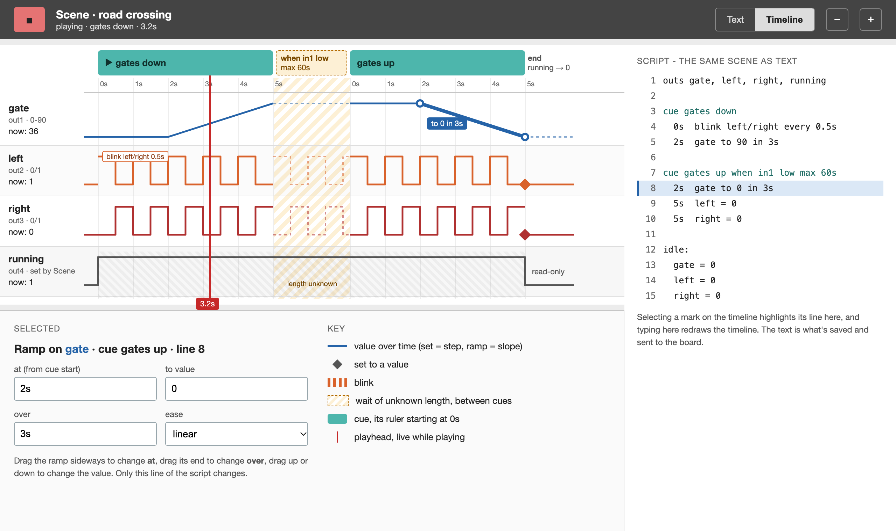
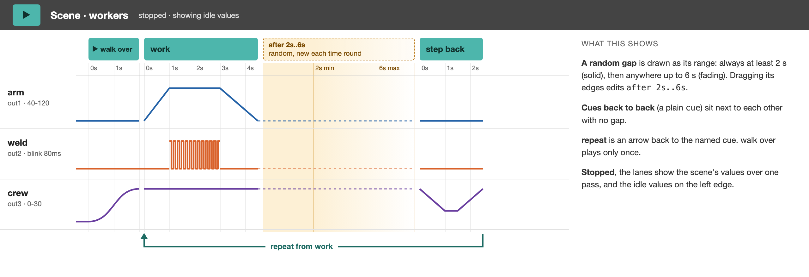

# Scene widget

**Status:** plan only (2026-10-30). Not started. Replaces the draft
in [DCC widgets](dcc-ex-widgets.md#scene-widget-draft-needs-refinement);
design decided with Phil (see "Decided" at the end).

A general NTK widget, not DCC-specific: a short script that plays out a
little story across a few outputs - a road crossing (lights flash, bell
rings, gates come down, wait for the train to clear, gates go up),
workers on a building site (an arm swings, a welding light flickers, a
pause of random length, again). Today the same story is a tangle of
Pulse, Gate, IfThen and Sequence widgets that nobody can read back a
week later. Scene makes it one readable list.

It's for any kind of project, not only the railway: a shop-window
display, an automaton, a lighting cue for a model.

## The script: cues

**Decided 2026-10-30:** a text script made of **cues**, the way a
theatre lighting or sound desk works. Phil finds it easier to read than
a list of waits, and it's the shape a visual timeline can be put on
later (see [Timeline view](#timeline-view-later)).

- A scene is a list of cues. **Each cue starts on an event**: play, a
  sensor, or a (possibly random) time after the cue before it.
- **Inside a cue every line has its own time, counted from the start
  of that cue.** Lines don't wait for each other.

```
outs gate, left, right, bell        # names for out1-out4

cue gates down                      # starts on play
  0s   blink left/right every 0.5s  # crossing lights, alternating
  0s   bell = 1
  2s   gate to 90 in 3s             # down by 5s

cue gates up when in1 low max 60s   # the train has cleared
  2s   gate to 0 in 3s
  5s   left = 0                     # stops the blink
  5s   right = 0
  5s   bell = 0

idle:                               # how the scene looks when idle
  gate = 0
  left = 0
  right = 0
  bell = 0
```

In the second cue, the gate starts up 2 s after `in1` goes low and the
lights go off 5 s after it, when the 3 s ramp has finished.

### Cues

| Cue line | Starts the cue |
|---|---|
| `cue` | On play, if it's the first cue; otherwise as soon as the cue before it has finished. |
| `cue after TIME` | TIME after the cue before it has finished. `cue after 2s..6s` picks a random time in that range each time - workers who don't move like clockwork. |
| `cue when in1 high` / `cue when in1 low` | When the cue before it has finished **and** the inlet is above / below the threshold. A level, not an edge: if the train had already cleared while the gates were still coming down, the cue starts straight away instead of waiting for an event it missed. Optional `max TIME`: give up waiting and start anyway, so a sensor that fails can't hold the gates down forever. |
| `cue NAME ...` | Any of the above with a name: the words between `cue` and `when` / `after` (or the end of the line), spaces allowed - `cue gates up when in1 low`. Shown in the widget and on the timeline, and used by `repeat from NAME`. |
| `repeat` / `repeat from NAME` | On its own line after the last cue: once the last cue has finished, go back to the first cue (or the named one). |

- **Name every cue.** The name is optional to the parser, but the
  starter script and every example in the docs name theirs: a name
  says what the cue is for (`gates down`, `gates up`), which a number
  doesn't, and it's the label of the cue's block on the timeline. Names
  must be unique in a scene, and can't use the words `when` or `after`.
- **A cue has finished** when its last line has happened and its last
  ramp has reached its end. A blink with no `for` doesn't count - it
  runs until something sets that outlet or the scene ends.
- The script's own events (`cue when`, `max`) are the only waits whose
  length isn't known in advance, and random times appear only on cue
  starts. So inside a cue everything happens at a fixed time - which is
  what lets a timeline draw it exactly.

### Lines inside a cue

Each line is `TIME  ACTION`. The time can be left out for `0s`.

| Action | Does |
|---|---|
| `NAME = VALUE` | Sets an outlet. A number, or `"text"` in quotes (for a Display). |
| `NAME to VALUE in TIME` | Ramps an outlet from where it is to VALUE over TIME. Optional `ease NAME` at the end, with Tween's easing names (`ease sine`, `ease bounce` ...). |
| `blink NAME every TIME` | Flips the outlet between 1 and 0 until something else sets it. `blink a/b every TIME` alternates two outlets (crossing lights). Optional `between LO and HI` (e.g. `between 0 and 255` for a LED), optional `for TIME` to stop by itself (back to LO). |

- **Names:** `outs a, b, c, d` at the top names out1-out4; `out1` ...
  `out4` always work too. The name `running` is special - see
  [Inlets and outlets](#inlets-and-outlets).
- **Times** need a unit: `2s`, `1.5s`, `500ms`. A bare number is an
  error with a clear message, not a guess - Pulse and Sequence count in
  ms, a scene reads naturally in seconds, and a silent mixup would be a
  gate moving 1000 times too slowly.
- **Lines may be in any order** inside a cue; they run in time order,
  and lines with the same time in the order written. The timeline view
  will write them in time order.
- **Two things on one outlet:** a new set, ramp or blink replaces
  whatever was still running on that outlet.
- Indenting the lines under their `cue` is for reading only; `#` starts
  a comment.
- **The scene ends** when its last cue has finished: outlets keep their
  last values, open blinks stop at their low value, `running` goes to 0.

### The idle section

The lines after `idle:` say how the scene looks when it isn't playing.
They take the same actions, with times counted from the moment they
start.

- **When the patch loads** (and when the script is edited), the idle
  lines are applied **instantly** - ramps jump to their end value, times
  are ignored - so a servo starts where the scene expects it, not at 0.
- **When `stop` arrives** (or the stop button), the idle lines are
  **played**: the crossing's gates go back up over 3 s, not with a jerk.
  `stop` during the idle section does nothing.
- With no idle section, `stop` freezes the outlets where they are.

This replaces the draft's "freeze vs return to start" option and
Sequence's "return to ... with a duration of ..." fields.

### Second example: workers

```
outs arm, weld, crew

cue walk over
  0s     crew to 30 in 2s ease sine     # a worker walks over

cue work
  0s     arm to 120 in 1s
  1s     blink weld every 80ms for 2s
  3s     arm to 40 in 1.5s

cue step back after 2s..6s              # a pause, different each time
  0s     crew to 10 in 1s
  1.5s   crew to 30 in 1s

repeat from work

idle:
  arm = 40
  weld = 0
  crew = 0
```

## What it looks like

### Main body (94x110, as every widget)

- **Play / stop button** - plays the scene with nothing wired in, so a
  whole scene can be tried before any sensor exists (CLAUDE.md
  principle).
- **The current cue** - its name (`cue 2` if it has none) - and a
  progress bar
  through it.
- **While a cue waits for its start**, what it's waiting for
  (`in1 low`, `2.4s`), flashing, like IfThen's pending blink - so a
  scene stuck on a sensor that never fires doesn't look broken.
- **Four small bars**, one per outlet, showing each outlet's value as
  the scene runs - the scene can be followed with nothing wired to the
  outlets.
- **Red "script error"** when the script doesn't parse; the play button
  does nothing until it's fixed.

### Inlets and outlets

- **Inlets:** `start` (plays from the first cue when it rises above the
  threshold), `stop` (same, stops), `in1`, `in2` (read by `cue when`).
- **Outlets:** `out1`-`out4` - four, the most any widget has, so the
  standard layout holds.
- **`running`** (1 while the scene plays, 0 when it's stopped or has
  finished) is **one of those four, chosen in the script**: naming an
  outlet `running` in the `outs` line (`outs gate, left, right,
  running`) makes it report that instead of a value. The script can't
  set it (`running = 1` is an error), and on the timeline it's a
  read-only lane. Uses: chaining one scene into another, a "busy" LED or
  Display line, gating a second sensor while a scene plays, holding a
  signal at red until the crossing has finished.
- A scene that needs four values *and* `running` doesn't fit: one value
  moves to a second Scene started from the same sensor.

### More panel

- **The script**: a textarea, as in Sequence, wide enough for
  `2s   blink left/right every 0.5s`. Checked as it's typed; a line that
  doesn't parse is listed under the box with what's wrong ("line 4: add
  `s` or `ms` to 3"), so a designer can fix it without guessing.
- **Threshold** for `start`, `stop`, `in1`, `in2` (default 512, like
  Sequence / Pulse).
- **If `start` arrives while playing:** ignore (default) or start over.

A new Scene starts with the crossing script in it, to edit rather than
start from blank.

## Timeline view (later)

Not part of the first build, but the script format is chosen so it can
be added without changing the format or the board.

**Mockup (2026-10-30):**
[Scene timeline mockup](https://claude.ai/artifact/ATQkpSj9D1r5QKWoa4qQKG)
- a claude.ai canvas, private to Phil's account. Two boards: the road
crossing playing (cue blocks, lanes, playhead, a selected ramp with
its inspector, the script beside it with the same line highlighted),
and the workers (a random gap drawn as its range, `repeat` as an arrow
back). A rough sketch, not a final design.





- **One lane per outlet**, time running left to right, like animation
  software. Each lane draws its outlet's value over time: a set is a
  step, a ramp a slope (with its easing curve), a blink a striped band,
  text a label.
- **Each cue is a block** as long as the cue. Between blocks, a marker
  says what starts the next one: `▶ play`, `in1 low · max 60s`, or a
  shaded gap for `after 2s..6s`. `repeat` is an arrow back.
- **Dragging edits one number:** moving a mark changes its line's time;
  stretching a ramp changes its `in TIME`; dragging up or down changes
  the value. Nothing else in the cue moves, because no line's time
  depends on another's. Lengthening a cue's last ramp makes the block
  longer and pushes the later blocks right, as it would on stage.
- **A playhead** follows the scene while it runs, in NTK and (if
  Monitor reports it) on the board.
- **Where it opens:** too big for the widget - a separate panel from
  the more panel's "Timeline" button. Its place in the UI is to design
  when it's built.

**How text and timeline stay one thing:** the script text is what's
saved, sent to the board and copied. NTK parses it into a list of cues
and lines that remembers each line's position and comment. The text
box and the timeline are two editors on that list: an edit in the
timeline rewrites only the line it changed, in place, keeping its
comment and the rest of the text as typed. The board never sees
anything but text, so the timeline needs no firmware change.

**Rules the format keeps for this** (and that the parser enforces from
the start, so no script written now breaks the timeline later):

- every line's time is its own, counted from its cue's start - no
  "after the line above";
- waits of unknown length (`cue when`) and random times (`cue after
  A..B`) only at cue starts;
- outlet names declared once, at the top - they're the lane labels.

## How it runs

### Timing

- **In NTK:** driven by the frame callback
  (`timingController.registerFrameCallback`, as Pulse and Encoder do),
  with `Date.now()` - **not** Velocity, which Sequence uses. Velocity's
  timing can't be reproduced on the board, and Scene must behave the
  same in both.
- **On the board:** a `_eval_scene` step in the interpreter's
  `BESPOKE_EVAL`, timed by `monotonic()` checks on each tick like
  `_eval_pulse` / `_eval_tween`. Nothing ever sleeps or blocks.
- **Each tick:** if the current cue is waiting to start, check its
  trigger (time, inlet, `max`). Once it's running, do every line whose
  time has come and hasn't been done, then update the running ramps and
  blinks; when the cue has finished, move to the next one. Several
  zero-length cues can pass in one tick, up to a fixed limit, so a
  `repeat` over cues with no time in them can't hang the board - it's
  reported as a script error instead.
- **Random times** come from a random function the runner is given, so
  the tests can give it a fixed sequence.

### One parser, written twice, tested together

The script is parsed once (on load / edit) into a list of cues and
lines, in JS (`app/scripts/utils/SceneScript.js`) and in Python (in the
interpreter). The runner works on that list, never re-reads the text.
The JS parse also keeps each line's position and comment, for the
timeline later; the board's doesn't need them.

To keep the two the same:

- **Shared test cases** in one JSON file (`test/scene-cases.json`):
  each case is a script, a list of inlet changes at given times, and
  the expected outlet values at given times. A Node script runs them
  against `SceneScript.js` (written so it loads in Node as well as
  RequireJS), a CPython script runs them against the interpreter's
  Scene step. Both must pass. Error messages are cases too, so the
  board and NTK reject the same scripts with the same words.
- The interpreter reuses `_ease` / `_EASINGS` (shared with Tween), so
  easing names are the same as Tween's.

### Standalone and Monitor

- Added to both portable lists (`StandaloneCompatibility.js`,
  `PORTABLE_TYPE_IDS`) and to `OUTS_BY_TYPE`.
- Memory on the board: the parsed cues are small tuples; a 40-line
  script is a few hundred bytes.
- **Monitor mode:** the outlet values already come back. Whether the
  current cue and progress can come back too depends on how Monitor
  reports widget state (to check); if not, Monitor shows the outlets
  and `running` only, and says so.

## What it connects to

- **Servo** (gates, arms, doors), **DigitalOut** / **AnalogOut** (lamps,
  a bell module), **NeoPixel** (welding flicker, signal colours via a
  value), **Display** (`sign = "CLOSED"`).
- **DCC Turnout** `in` and the virtual turnouts in the
  [DCC plan](dcc-ex-widgets.md): a scene can throw a turnout, or start
  a cue on one (a turnout wired into `in1`).
- **DCC Throttle** speed - a scene could run a shunting move. Possible,
  but a train ramping on a timer has no idea where it is; the docs
  should say to use it only on a dead-end siding, with a sensor and a
  `max` on the cue that stops it.
- **Another Scene's `start`** via `running`, for scenes that follow on.

## Phases

1. **Script format and runner in JS** (`SceneScript.js`): parser,
   error messages, runner, the shared JSON test cases and the Node
   test script. No UI yet.
2. **The widget in NTK**: main body, more panel with the script editor
   and error list, the idle section applied on load, frame-callback
   timing. Tried with Servo / DigitalOut and with no hardware.
3. **Interpreter step** passing the same test cases under CPython; then
   on the XIAO: the road crossing with two LEDs and a servo, started by
   a button, with a second button as "train cleared".
4. `docs/scene.md` with both examples, the help link, and an example
   patch (crossing).
5. Later: the **timeline view**.

Also later, if wanted: `repeat N times`; picking one of several cues
at random; more than four outlets.

## Decided

- **2026-10-30:** a text script built from cues, with each line's time
  counted from its cue's start; the timeline view goes on top of it
  later. The idle section (named `idle:`, not `rest:` - "rest" read as
  "pause" or "the rest of the scene").
- **2026-10-30:** four outlets, the widget standard; `running` is any
  one of them, named so in the `outs` line - not a fifth outlet.
- **2026-10-30:** cues have names (`cue gates up when in1 low`),
  multi-word, used in every example; the parser still accepts an
  unnamed `cue`, shown as `cue 2`.
- **2026-10-30:** times always with a unit (`2s`, `500ms`); a bare
  number is an error. `cue when` is a level (starts if the inlet is
  *already* low), not an edge.
